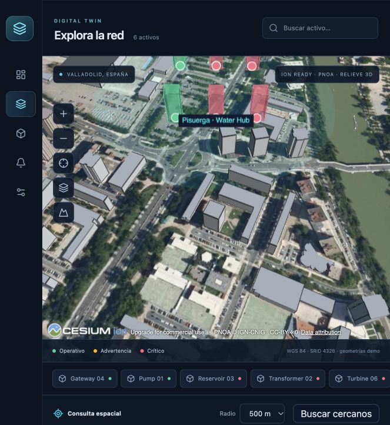
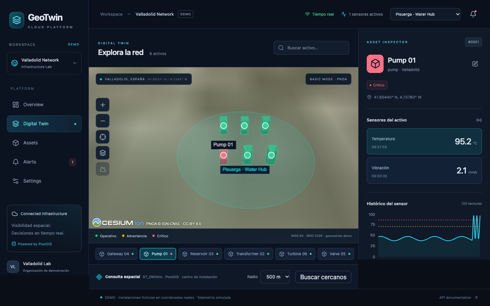
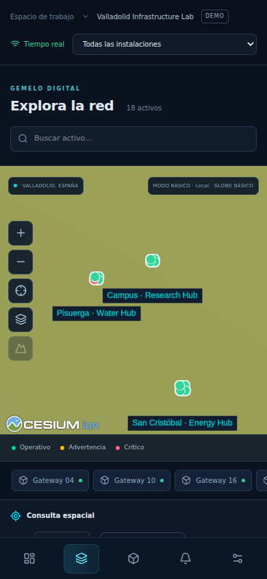

# GeoTwin Cloud

[](https://github.com/davidpalmerojara/geotwin-cloud/actions/workflows/ci.yml)

**English summary.** GeoTwin Cloud is a 3D digital twin for infrastructure monitoring: React + TypeScript + CesiumJS in the browser, a Fastify API with Zod/OpenAPI contracts, PostgreSQL/PostGIS and WebSockets. It is a single-organization local demo with no authentication; the facilities are fictional, the telemetry is simulated and nothing is deployed. Run it with `docker compose up -d --build --wait` and open `http://localhost:8080`.

**How it was built.** Code and docs generated by AI coding agents under my direction; I set scope and constraints, reviewed decisions and verified the result.



| Anomalía simulada en Pump 01 (atlas local, sin red)                           | Red completa en un móvil                                |
| ----------------------------------------------------------------------------- | ------------------------------------------------------- |
|  |  |

---

**Monitorización de infraestructuras con gemelos digitales 3D.** MVP integrado para demostrar ingeniería full-stack geoespacial: React, CesiumJS, Fastify, PostgreSQL/PostGIS y WebSockets.

Demo **de organización única**, sin autenticación. Tres instalaciones ficticias situadas en coordenadas geográficas reales de Valladolid, 18 activos, 36 sensores y 30 minutos de histórico inicial. Toda la operación y telemetría está explícitamente identificada como **simulada**. No representa ni controla infraestructuras reales.

## Arranque con Docker

Requisitos: Docker Engine / Docker Desktop con Compose v2, acceso a internet durante la construcción y espacio libre para las imágenes y la caché de construcción. En Apple Silicon se emula `linux/amd64` para la imagen oficial PostGIS. No necesitas Node en el host para esta opción.

```bash
cp .env.example .env
docker compose up -d --build --wait
```

Abre **http://localhost:8080**. Documentación interactiva: **http://localhost:8080/api/docs**. La API también escucha en `http://localhost:3001`, PostgreSQL en `localhost:55432`. Los puertos publicados se limitan a loopback.

La API aplica migraciones y, con `DEMO_MODE=true`, ejecuta seeds idempotentes antes de arrancar. Los datos permanecen en el volumen `pgdata`. `docker compose stop` detiene la demo conservando sus datos; `docker compose start` vuelve a arrancarla. Para revisar errores: `docker compose logs --tail=100 api web db`. **No borres el volumen para una actualización normal.**

## Desarrollo local

Node **24 LTS recomendado** (mínimo 22.13), npm 10 o superior y Docker para PostgreSQL/PostGIS. Usa `.nvmrc` si trabajas con nvm. No mantengas al mismo tiempo la API de Compose y la API local en el puerto 3001.

```bash
cp .env.example .env
npm ci
docker compose up -d db --wait
npm run db:migrate
npm run db:seed
npm run dev
```

Abre **http://localhost:5173**. Vite redirige REST y WebSocket a la API. `npm run dev` compila automáticamente el paquete compartido; si modificas sus contratos, vuelve a compilarlo con `npm run build -w @geotwin/shared` o reinicia dev.

```bash
npm run build           # contratos, API y web de producción
npm run typecheck      # TypeScript estricto, incluye tests
npm run lint
npm run format:check
```

`npm run start -w @geotwin/api` usa la API compilada. Para servir la web de producción integrada usa la imagen nginx de Compose; `vite preview` por sí solo no es un servidor API.

## Qué funciona

- Dashboard calculado mediante SQL, filtros por instalación y tendencia de sensores.
- Visor Cesium real: la cámara encuadra los activos (toda la red o la instalación elegida) en escritorio y en móvil, selección mediante clic, fly-to, marcadores y volúmenes de activos con color operativo, búsqueda y controles de navegación. Cambiar de instalación no reconstruye el visor.
- Inspector de activos con sensores, última lectura, histórico y umbrales. Edición persistente del nombre, que llega a los demás clientes por WebSocket.
- Enlaces compartibles: la vista, la instalación y el activo seleccionados viven en la URL (por ejemplo `/gemelo?instalacion=…&activo=…`). Abrir el enlace muestra lo mismo y el botón Atrás del navegador vuelve a la vista anterior.
- Telemetría cada 5 segundos, persistida antes de publicar eventos; secuencia reproducible y anomalías periódicas. Cada tick usa un número fijo de sentencias SQL, sea cual sea el número de sensores.
- Fallos controlados desde la UI: una lectura crítica crea una incidencia, actualiza el activo y se propaga a clientes conectados.
- Registro manual de incidencias y resolución idempotente con histórico de resolución.
- Reconexión WebSocket con espera exponencial y sincronización REST. Las lecturas y los cambios de estado se escriben directamente en la caché de TanStack Query; solo las alertas provocan una recarga REST. Zustand conserva únicamente estado de interfaz, sincronizado con la URL.
- Retención configurable de lecturas (`READINGS_RETENTION_HOURS`, 24 h en la demo).
- Proximidad PostGIS con `ST_DWithin(location::geography, point::geography, radius)` e índice GiST sobre la misma expresión. El radio y la distancia se expresan en metros. La búsqueda se centra en el activo seleccionado, si no en la instalación elegida y, si no, en el centro de la red.
- OpenAPI generado desde los mismos esquemas Zod usados para entrada, salida y contratos compartidos.

## Cesium sin token

No necesitas cuenta de Cesium para el flujo principal. La aplicación arranca con globo elipsoidal, ortofotos PNOA del IGN y geometrías de activos. Workers, Widgets, Assets y ThirdParty se sirven desde `/cesium/` tanto en Vite como en nginx.

PNOA necesita conexión a internet. Se conservan créditos de IGN-CNIG y su licencia CC-BY 4.0; [servicio oficial](https://pnoa.ign.es/pnoa-imagen/visualizadores-y-servicios-web). El botón **Alternar cartografía** cambia a la cartografía Natural Earth de baja resolución incluida localmente con Cesium, manteniendo selección y navegación. Sin ion no hay terreno de alta resolución ni edificios fotogramétricos. Los volúmenes de colores son representaciones **demo** de activos, y los círculos de instalación son áreas orientativas, no límites catastrales.

Opcionalmente configura `VITE_CESIUM_ION_TOKEN` y reconstruye la web. El botón **Edificios 3D** carga conjuntamente **Cesium World Terrain** y **Cesium OSM Buildings**. El token necesita lectura de **ambos assets** (terreno: 1; edificios: 96188) y autorización de la URL utilizada, por ejemplo `http://localhost:8080`. Si falta permiso para el terreno, los edificios no se muestran sobre el globo básico. Marcadores, volúmenes y áreas se ajustan al suelo mediante referencias de altura de Cesium; no se desplaza artificialmente el tileset. Un error conserva el visor básico. Una variable `VITE_*` es **pública en el bundle**: utiliza exclusivamente un token ion de lectura, restringido a los assets y dominios necesarios; nunca un token privado con permisos de escritura.

## Tests

```bash
npm test                      # 30 pruebas unitarias: dominio, contratos, ion, cámara, caché realtime, cliente API, formato, rutas
npm run test:integration       # crea/migra geotwin_test; 28 pruebas con PostGIS real
npx playwright install chromium
npm run test:e2e               # arranca API y Vite para el flujo real en Chromium
```

Las pruebas de integración requieren PostgreSQL activo en 55432. Utilizan **únicamente** la base `geotwin_test` y rechazan otro nombre antes de limpiar fixtures. `TEST_DATABASE_URL` permite ajustar host y credenciales. El usuario local de PostgreSQL debe poder crear esa base; si no existe, se crea desde la base de mantenimiento `postgres` del mismo servidor. No uses una base de negocio para los tests.

El E2E también usa `geotwin_test`, desactiva el simulador periódico y mantiene disponible la inyección controlada; no usa mocks de REST. Selecciona la capa local real para que el test no dependa del servicio de ortofotos. Necesita los puertos 3001 y 5173 libres y un navegador con WebGL (se configura SwiftShader en CI). Los informes de fallo se guardan en `test-results/`. La CI ejecuta checks, integración, build, E2E y un arranque de Compose; los resultados y la fecha de cada ejecución están en [docs/verification.md](docs/verification.md).

Si los puertos 3001 o 5173 están ocupados, `API_PORT` y `WEB_PORT` cambian los de Vite, su proxy y los servidores del E2E. `PLAYWRIGHT_CHROMIUM_PATH` usa un Chromium ya instalado cuando no coincide con la versión fijada de Playwright.

Para probar una instancia Compose ya iniciada, puedes ejecutar el mismo smoke test con `E2E_BASE_URL=http://localhost:8080 npm run test:e2e`. Esto **crea y resuelve una anomalía de demo** en el activo Pump 01 de esa instancia; úsalo solo en una demo descartable o local.

## Variables de entorno

| Variable                                            | Uso                                                                                  |
| --------------------------------------------------- | ------------------------------------------------------------------------------------ |
| `DATABASE_URL`                                      | Conexión PostgreSQL de la API; no se envía al navegador                              |
| `TEST_DATABASE_URL`                                 | Base exclusiva `geotwin_test` para tests                                             |
| `POSTGRES_USER`, `POSTGRES_PASSWORD`, `POSTGRES_DB` | Inicialización local de Compose; cambian solo al crear un volumen nuevo              |
| `PORT`, `HOST`                                      | API local, por defecto 3001 / 127.0.0.1                                              |
| `CORS_ORIGIN`                                       | Lista de orígenes HTTP y WebSocket separados por comas                               |
| `DEMO_MODE`                                         | Expone `/api/demo/anomalies` solo si es `true`; por defecto seguro `false` en código |
| `SIMULATOR_ENABLED`                                 | Activa el generador periódico; por defecto `true`                                    |
| `SIMULATOR_INTERVAL_MS`                             | Cadencia, mínimo 1000; por defecto 5000                                              |
| `READINGS_RETENTION_HOURS`                          | Horas de lecturas que se conservan; 24 en la demo, 0 (conservar todo) en código      |
| `VITE_CESIUM_ION_TOKEN`                             | Token público de lectura opcional; requiere reconstrucción del frontend              |
| `API_UPSTREAM`                                      | nginx: `api:3001` en Compose, `127.0.0.1:3001` en la tarea ECS propuesta             |

Las credenciales de `.env.example` son exclusivamente locales. `.env` está ignorado por Git y excluido del contexto Docker. `.env.example` se copia para arrancar la demo; el simulador y el control de anomalías se activan expresamente allí.

## Documentación

- [Arquitectura y decisiones](docs/architecture.md)
- [Endpoints, eventos y ejemplos](docs/api.md)
- [Demo de 90 segundos](docs/demo-guide.md)
- [Plan de despliegue en AWS (no ejecutado)](docs/aws.md)
- [Pruebas y verificación](docs/verification.md)

## Limitaciones y siguientes pasos

P0 implementado y flujo principal verificado también sobre Docker Compose, con el alcance de verificación registrado en `docs/verification.md`. P1 pendiente: OIDC, autorización por recurso y aislamiento multiempresa efectivo. El `organization_id` actual identifica una organización fija del servidor; **no constituye seguridad multiempresa**. No expongas esta demo como un SaaS de producción.

La simulación resuelve un fallo eliminando su override e insertando una lectura basal. En un sistema físico, resolver una incidencia y recuperar un sensor son operaciones distintas. La salud actual se deriva de incidencias activas. Las anomalías **naturales** del simulador se cierran solas cuando la lectura vuelve al rango normal (`resolved_by = auto_recovery`); las inyectadas desde la UI y las manuales siguen activas hasta que alguien las resuelve.

La retención borra lecturas antiguas por sensor, en lotes; no hay particionado. Las listas están pensadas para la pequeña red demo (alerts máximo 500; lectura de detalle máximo 500). Antes de escalar: paginación por cursor, particionado por fecha, retención, límites de peticiones, observabilidad y backups con ensayo de restauración. El hub WebSocket vive en un solo proceso; debe mantenerse **una réplica** hasta introducir un mecanismo de difusión compartido si hay necesidad real. Añadir autenticación antes de cualquier publicación.

El módulo Cesium pesa aproximadamente 4 MB minificados y se descarga al abrir el gemelo digital; nginx lo sirve comprimido con gzip (unos 1,1 MB). Su build produce un aviso de tamaño esperado; no se oculta. Importador GeoJSON y análisis espacial adicional quedan en P2.

## Datos y bibliotecas de terceros

- **Ortofoto PNOA** © Instituto Geográfico Nacional (IGN-CNIG), servicio WMTS, licencia [CC-BY 4.0](https://creativecommons.org/licenses/by/4.0/). El crédito se muestra en el visor.
- **Natural Earth II** (cartografía local de baja resolución incluida en CesiumJS): dominio público.
- **CesiumJS**: Apache-2.0.
- **Cesium ion** (opcional, solo con token): Cesium World Terrain y Cesium OSM Buildings, sujetos a los términos de Cesium ion; los edificios proceden de © colaboradores de OpenStreetMap (ODbL).
- **PostgreSQL** (PostgreSQL License) y **PostGIS** (GPL-2.0), usados como servicio desde la imagen `postgis/postgis`.
- React, Fastify, TanStack Query, Zustand, Zod, Recharts, Radix UI, Tailwind CSS y node-postgres: MIT. Iconos Lucide: ISC.

## Licencia

Código bajo licencia [MIT](LICENSE). Los datos de terceros conservan sus propias licencias.
