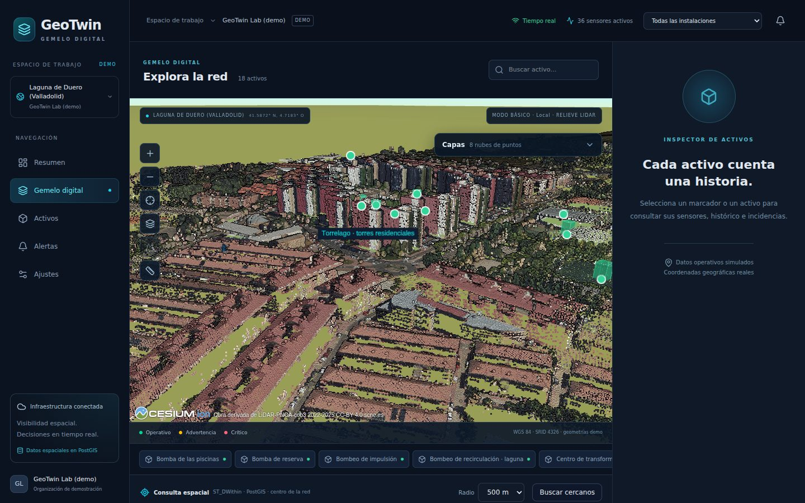
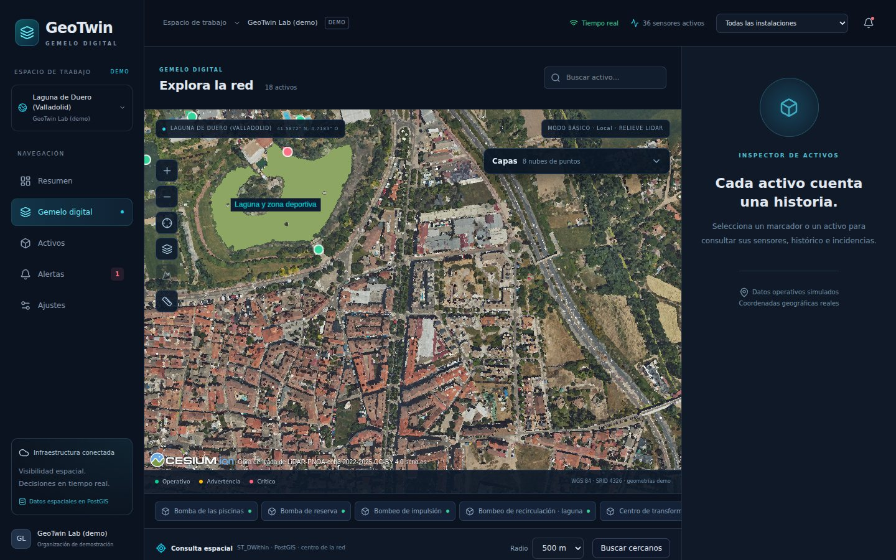
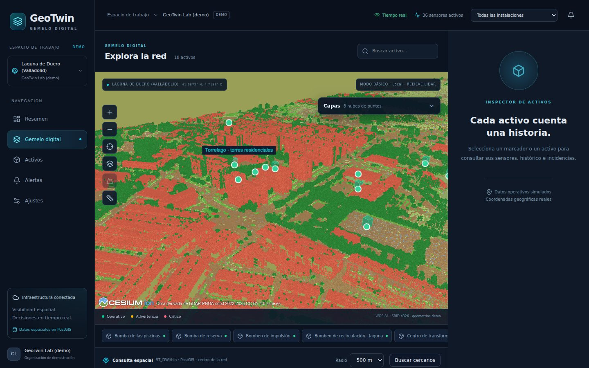
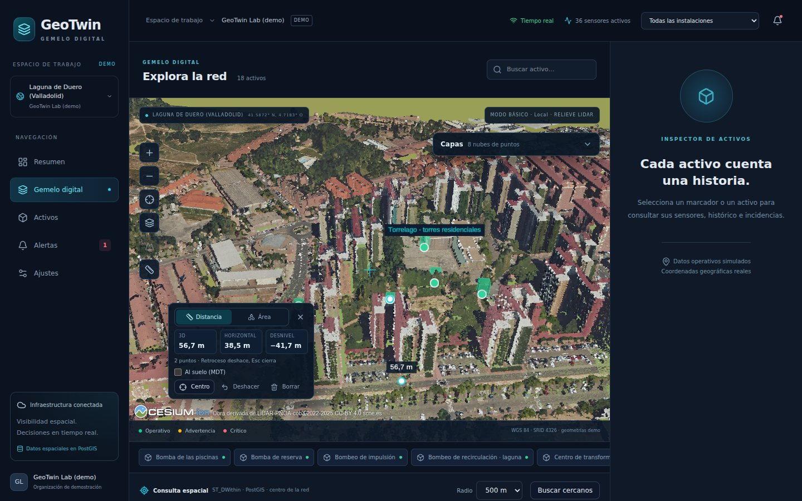
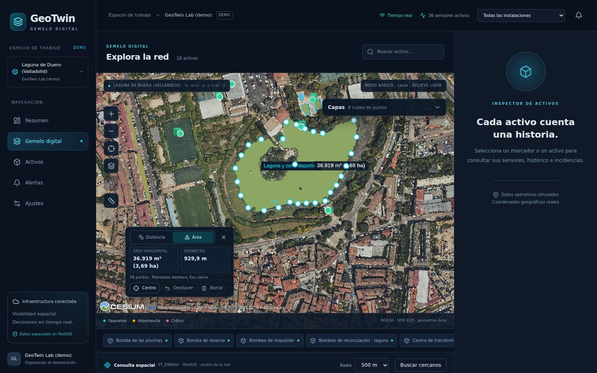
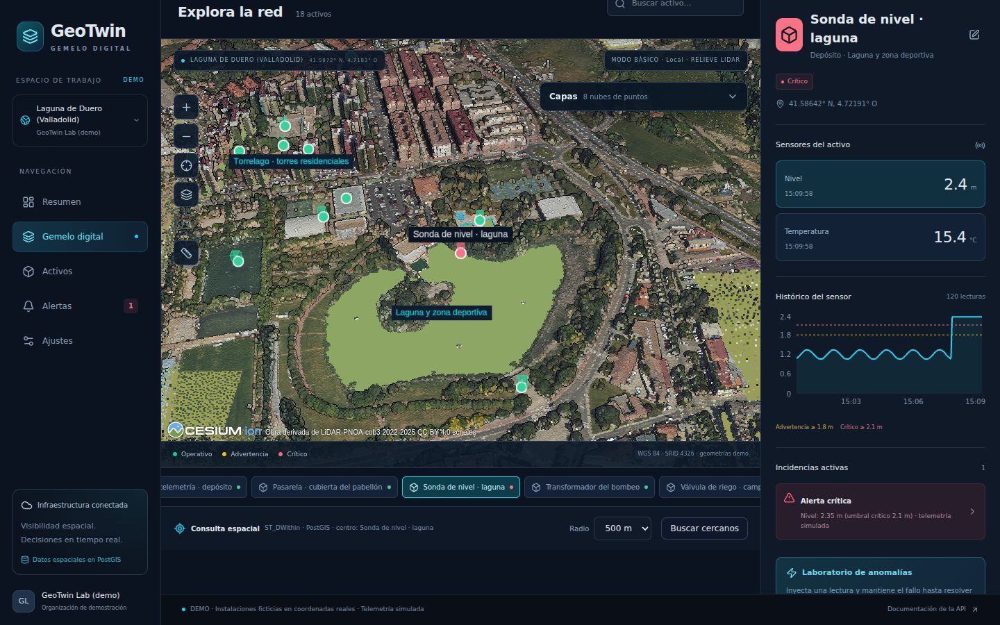
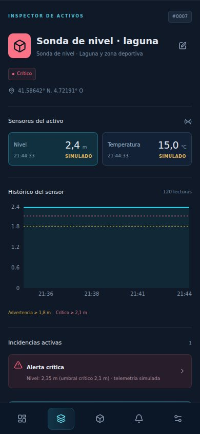

# GeoTwin Cloud

[](https://github.com/davidpalmerojara/geotwin-cloud/actions/workflows/ci.yml)

**English summary.** GeoTwin Cloud is a 3D digital twin for infrastructure monitoring: React + TypeScript + CesiumJS in the browser, a Fastify API with Zod/OpenAPI contracts, PostgreSQL/PostGIS and WebSockets. It is a single-organization local demo with no authentication; the facilities are fictional, the telemetry is simulated and nothing is deployed. LiDAR point clouds (LAS/LAZ, e.g. PNOA-LiDAR tiles) can be uploaded through the API: they are streamed to S3-compatible storage (MinIO in Compose), queued with pg-boss on PostgreSQL and converted to 3D Tiles by a separate worker (py3dtiles), with the orthometric-to-ellipsoidal height correction, strip-overlap and noise points left out, a 2 m ground model (DTM) built from the ground class and live progress over WebSockets. The default scenario is **Laguna de Duero (Valladolid)**: eight real PNOA-LiDAR tiles (63.6 M points, 488 MB of LAZ, about 30 s each on 4 CPUs) loaded through that pipeline, their DTM used as the viewer's terrain without Cesium ion, and fictional assets placed on spots checked in the cloud (tower roofs, the lake shore, a 33 m tank-shaped structure) with simulated telemetry. A "Capas" panel uploads files, follows processing live and styles the clouds (RGB, height, ASPRS classification), drawn as round points with optional eye-dome lighting and per-device quality presets; a measuring tool gives 3D and geodesic distances, height differences and areas. With a Cesium ion token, an optional "Fotorrealista (Google)" layer streams Google Photorealistic 3D Tiles under the assets (not testable in the build environment, which has no access to Cesium ion; see docs/fotorrealista.md). Run it with `docker compose up -d --build --wait` and open `http://localhost:8080`.

**How it was built.** Code and docs generated by AI coding agents under my direction; I set scope and constraints, reviewed decisions and verified the result.



| Laguna de Duero en RGB (8 hojas PNOA-LiDAR reales)                                                   | Modo Clasificación (ASPRS)                                                   |
| ---------------------------------------------------------------------------------------------------- | ---------------------------------------------------------------------------- |
|  |  |

| Altura de una torre de Torrelago medida en el visor                                             | Área de la laguna medida en el visor                                                 |
| ----------------------------------------------------------------------------------------------- | ------------------------------------------------------------------------------------ |
|  |  |

| Alerta **simulada** en la sonda de nivel de la laguna                   | Móvil (390 px) con una alerta simulada                                         |
| ----------------------------------------------------------------------- | ------------------------------------------------------------------------------ |
|  |  |

**Vídeo (40 s):** [MP4](docs/video/laguna-demo.mp4) · [WebM](docs/video/laguna-demo.webm): vista general de Laguna de Duero, descenso a Torrelago, modos de color, medición de una torre (41,7 m de desnivel) y una alerta **simulada** en la sonda de la laguna, con los puntos redondos y sin contornos. Grabado fotograma a fotograma en calidad Media con un renderizador por software (uno o dos minutos por fotograma) y el mapa local de baja resolución bajo la nube: la ortofoto PNOA no era accesible desde el entorno de grabación. Nube: _Obra derivada de LiDAR-PNOA-cob3 2022-2025 CC-BY 4.0 scne.es_.

---

**Monitorización de infraestructuras con gemelos digitales 3D.** MVP integrado para demostrar ingeniería full-stack geoespacial: React, CesiumJS, Fastify, PostgreSQL/PostGIS y WebSockets.

Demo **de organización única**, sin autenticación. Tres instalaciones ficticias en **Laguna de Duero (Valladolid)**, situadas sobre lugares reales que se reconocen en la nube LiDAR, con 18 activos, 36 sensores y 30 minutos de histórico inicial (el escenario anterior, en Valladolid capital, sigue disponible con `DEMO_SEED=valladolid`). Toda la operación y telemetría está explícitamente identificada como **simulada**. No representa ni controla infraestructuras reales, tampoco las del municipio.

## Arranque con Docker

Requisitos: Docker Engine / Docker Desktop con Compose v2, acceso a internet durante la construcción y espacio libre para las imágenes y la caché de construcción. En Apple Silicon se emula `linux/amd64` para la imagen oficial PostGIS. No necesitas Node en el host para esta opción.

```bash
cp .env.example .env
docker compose up -d --build --wait
```

Abre **http://localhost:8080**. Documentación interactiva: **http://localhost:8080/api/docs**. La API también escucha en `http://localhost:3001`, PostgreSQL en `localhost:55432` y MinIO en `localhost:9000` (consola en `9001`). Los puertos publicados se limitan a loopback. Compose arranca también el **worker** que convierte las capas LiDAR.

La API aplica migraciones y, con `DEMO_MODE=true`, ejecuta el seed idempotente del escenario elegido (`DEMO_SEED`: `laguna-de-duero` por defecto o `valladolid`) antes de arrancar. Una base guarda el escenario con el que se sembró por primera vez; para cambiarlo, usa un volumen nuevo. Los datos permanecen en el volumen `pgdata`. `docker compose stop` detiene la demo conservando sus datos; `docker compose start` vuelve a arrancarla. Para revisar errores: `docker compose logs --tail=100 api worker web db`. **No borres el volumen para una actualización normal.**

## Desarrollo local

Node **24 LTS recomendado** (mínimo 22.13), npm 10 o superior y Docker para PostgreSQL/PostGIS. Usa `.nvmrc` si trabajas con nvm. No mantengas al mismo tiempo la API de Compose y la API local en el puerto 3001.

```bash
cp .env.example .env
npm ci
docker compose up -d db --wait
npm run db:migrate
npm run db:seed
npm run dev
```

Abre **http://localhost:5173**. Vite redirige REST y WebSocket a la API. `npm run dev` arranca API, worker y web, y compila antes los paquetes compartidos (`@geotwin/shared` y `@geotwin/storage`); si modificas sus contratos, reinicia dev. En local las capas se guardan en `data/storage` (`STORAGE_DRIVER=local`). El worker necesita Python 3.12 o posterior con las dependencias fijadas:

```bash
python3 -m venv .venv && .venv/bin/pip install -r apps/worker/python/requirements.txt
echo "LIDAR_PYTHON=$PWD/.venv/bin/python" >> .env
```

```bash
npm run build           # contratos, API y web de producción
npm run typecheck      # TypeScript estricto, incluye tests
npm run lint
npm run format:check
```

`npm run start -w @geotwin/api` usa la API compilada. Para servir la web de producción integrada usa la imagen nginx de Compose; `vite preview` por sí solo no es un servidor API.

## Qué funciona

- Dashboard calculado mediante SQL, filtros por instalación y tendencia de sensores.
- Visor Cesium real: la cámara encuadra los activos (toda la red o la instalación elegida) en escritorio y en móvil, selección mediante clic, fly-to, marcadores y volúmenes de activos con color operativo, búsqueda y controles de navegación. Cambiar de instalación no reconstruye el visor.
- Inspector de activos con sensores, última lectura (con coma decimal y la marca «simulado» junto a cada valor), histórico y umbrales. Edición persistente del nombre, que llega a los demás clientes por WebSocket.
- Enlaces compartibles: la vista, la instalación y el activo seleccionados viven en la URL (por ejemplo `/gemelo?instalacion=…&activo=…`). Abrir el enlace muestra lo mismo y el botón Atrás del navegador vuelve a la vista anterior. Si el relieve del LiDAR llega después del primer vuelo, la cámara vuelve a apuntar al suelo real, salvo que ya la hayas movido.
- Telemetría cada 5 segundos, persistida antes de publicar eventos; secuencia reproducible y anomalías periódicas. Cada tick usa un número fijo de sentencias SQL, sea cual sea el número de sensores.
- Fallos controlados desde la UI: una lectura crítica crea una incidencia, actualiza el activo y se propaga a clientes conectados.
- Registro manual de incidencias y resolución idempotente con histórico de resolución.
- Reconexión WebSocket con espera exponencial y sincronización REST. Las lecturas y los cambios de estado se escriben directamente en la caché de TanStack Query; solo las alertas provocan una recarga REST. Zustand conserva únicamente estado de interfaz, sincronizado con la URL.
- Retención configurable de lecturas (`READINGS_RETENTION_HOURS`, 24 h en la demo).
- Proximidad PostGIS con `ST_DWithin(location::geography, point::geography, radius)` e índice GiST sobre la misma expresión. El radio y la distancia se expresan en metros. La búsqueda se centra en el activo seleccionado, si no en la instalación elegida y, si no, en el centro de la red.
- OpenAPI generado desde los mismos esquemas Zod usados para entrada, salida y contratos compartidos.
- Panel **Capas** en el gemelo: subida de LAS/LAZ, progreso en vivo por WebSocket y nubes de puntos 3D Tiles en el visor con varios modos de color (detalle en [Capas en el visor](#capas-en-el-visor)).
- Herramienta **Medir**: distancia 3D y horizontal, desnivel y área sobre lo que se ve en pantalla (ver [Medición](#medición)).

## Laguna de Duero con datos reales

Ocho hojas de **PNOA-LiDAR, 3.ª cobertura** (vuelo de 2025, 1 × 1 km cada una, LAS 1.4 formato 8 con RGB de 16 bits e infrarrojo, 63,6 millones de puntos, 488 MB en LAZ, altitudes ortométricas REDNAP) cubren Laguna de Duero salvo una esquina. No están en el repositorio: se descargan del [Centro de Descargas del CNIG](https://centrodedescargas.cnig.es/) o, con acceso al repositorio, de su release `data-laguna`. Se cargan por la API, como cualquier usuario:

```bash
gh release download data-laguna --repo davidpalmerojara/geotwin-cloud --dir data/laguna
scripts/upload-layers.sh data/laguna/*.LAZ                          # Compose (http://localhost:8080)
scripts/upload-layers.sh -u http://localhost:3001 data/laguna/*.LAZ # npm run dev
```

Resultados medidos (detalle en [docs/laguna-de-duero.md](docs/laguna-de-duero.md)):

- **Pipeline**: de 28 a 37 s por hoja desde la subida hasta la capa lista (4 CPU, `TILER_JOBS=3`), 252 s las ocho; memoria del worker y py3dtiles hasta 694 MB; 771 MB de teselas y MDT para 47,7 millones de puntos dibujados.
- **Solape y ruido**: el 25 % de los puntos (clase 12, solape entre pasadas, y clase 7, ruido) no se dibuja; el resto, a densidad completa.
- **Datum vertical**: comprobado aparte del worker con la rejilla oficial EGM08-REDNAP leída a mano y una conversión ECEF → geodésicas propia: h = H + N con un residuo de 0,05 mm (la diferencia entre los elipsoides GRS80 y WGS84) en 400.000 puntos de suelo. N = 53,07-53,14 m.
- **Terreno**: el MDT de 2 m (clase 2) queda a 2 cm de mediana de los puntos de suelo y hace de relieve en el visor, así que mapa, activos y nubes coinciden en altura sin Cesium ion.
- **Medición**: una torre de Torrelago da 41,7 m en el visor frente a 41,8 m entre los puntos LiDAR de cubierta y suelo en esos mismos sitios (42,3 m hasta el nivel principal de la cubierta); el área de la laguna, 36.919 m², coincide al metro cuadrado con pyproj para los mismos vértices.

**Atribución** (CC-BY 4.0), visible en los créditos del visor mientras haya una capa PNOA visible: **«Obra derivada de LiDAR-PNOA-cob3 2022-2025 CC-BY 4.0 scne.es»**.

**Límites honestos.** Las instalaciones, los activos y sus lecturas son ficticios; solo su posición y altura salen de la nube. Fuera de las ocho hojas el terreno es un plano orientativo. La laguna se ve como un hueco en la nube (el agua no devuelve el láser), sin superficie de agua. Es **LiDAR aéreo**: unos 5 puntos/m² vistos desde arriba, con el color de una ortofoto cenital. Las cubiertas y el suelo abierto quedan bien; las fachadas tienen pocos puntos y los patios estrechos, ninguno (alrededor de Torrelago, el 19,5 % de las celdas de 1 m no tiene ningún punto). De cerca no puede parecerse a un escaneo terrestre: las capturas se hacen a media altura o en cenital. Las capturas se hicieron sin la ortofoto PNOA y con un renderizador por software, que deja las teselas lejanas con poco detalle; con GPU cargan en segundos.

## Capas LiDAR (nubes de puntos)

Cualquier fichero LAS o LAZ se puede subir a la API; un worker aparte lo convierte en un tileset **3D Tiles** (`.pnts` con color RGB y la clasificación ASPRS como atributo) que Cesium puede cargar con `Cesium3DTileset.fromUrl`. El diseño está pensado para hojas reales de **PNOA-LiDAR** (3.ª cobertura): LAZ de 1 × 1 km, 40-70 MB, unos 10-15 millones de puntos, ETRS89 / UTM 30N (EPSG:25830) y altitudes ortométricas (REDNAP).

1. **Subida** (`POST /api/layers`, multipart): el tipo se comprueba por contenido, no por extensión; el fichero va directo al almacenamiento en streaming mientras se calcula su SHA-256; un fichero repetido devuelve 409. Límite: 150 MiB (`LAYER_UPLOAD_MAX_BYTES`).
2. **Cola**: la capa y su job de **pg-boss** se crean en la misma transacción de PostgreSQL (sin Redis).
3. **Worker** (`apps/worker`, proceso y contenedor propios): descarga el original, lee la cabecera y todos los puntos con laspy; en una pasada deja fuera el solape y el ruido (clases 12, 7 y 18; `LIDAR_EXCLUDE_CLASSES`) y promedia el suelo (clase 2) en un **modelo del terreno de 2 m** (`DTM_CELL_M`); convierte con **py3dtiles** de EPSG:25830 a EPSG:4978, sube teselas y MDT a S3/MinIO y marca la capa como lista. Reintentos con espera exponencial, tiempo máximo, latido para detectar workers caídos y mensajes de error legibles.
4. **Progreso en vivo**: el worker publica con `NOTIFY` de PostgreSQL y la API lo reenvía por WebSocket (`layer:progress`, `layer:ready`, `layer:failed`).
5. **Teselas**: `GET /api/layers/:id/tiles/…` con `ETag` y caché inmutable.

**Altura correcta.** Las altitudes de PNOA son ortométricas y Cesium usa alturas elipsoidales; en Valladolid la diferencia (ondulación del geoide) es de unos **53 m**. Sin la rejilla oficial, el worker aplica EGM96 en el centro de la hoja: en Laguna de Duero queda unos **0,5 m** por encima del modelo oficial EGM08-REDNAP (detalle y presupuesto de error en [docs/architecture.md](docs/architecture.md#datum-vertical-de-altitudes-ortométricas-a-elipsoidales)). Con la rejilla oficial del IGN (CC-BY 4.0, 0,8 MB) se aplica punto a punto con PROJ:

```bash
mkdir -p data/geoid
curl -fL -o data/geoid/es_ign_egm08-rednap.tif https://cdn.proj.org/es_ign_egm08-rednap.tif
# Compose la monta en el worker; en desarrollo: GEOID_GRID_DIR=$PWD/data/geoid en .env
```

También se puede fijar la ondulación a mano por capa (`geoid_offset_m`) o para todo el worker (`GEOID_OFFSET_M`).

### Cargar una hoja real de PNOA-LiDAR

Descarga la hoja desde el [Centro de Descargas del CNIG](https://centrodedescargas.cnig.es/) (LiDAR → PNOA-LiDAR, tercera cobertura) y súbela con `scripts/upload-layers.sh` (ver [Laguna de Duero con datos reales](#laguna-de-duero-con-datos-reales)) o con `curl`; si el nombre empieza por `PNOA_`, la capa toma automáticamente la atribución obligatoria:

```bash
curl -F file=@PNOA_2025_CYL_356-4605_H30_NPC01.LAZ 'http://localhost:8080/api/layers'
curl http://localhost:8080/api/layers/ID_DEVUELTO   # status, progress y, al terminar, tileset_url
```

**Atribución obligatoria** (CC-BY 4.0), que debe acompañar a cualquier vista o derivado de esos datos: **«Obra derivada de LiDAR-PNOA-cob3 2022-2025 CC-BY 4.0 scne.es»**. La API la guarda en la capa (`attribution`) para que el visor la muestre.

Para probar sin datos reales: `apps/worker/tests/fixtures/synthetic-laguna-duero.laz` es una nube **sintética** (5.540 puntos generados, no medidos) con la misma forma que una hoja PNOA, y `scripts/smoke-layer.sh` la sube y espera al tileset. `python apps/worker/python/make_synthetic_fixtures.py <carpeta> --points 12000000` genera una hoja sintética de tamaño real para medir rendimiento.

**Medido** con una hoja sintética de 12 millones de puntos (LAZ de 86 MB, 1 × 1 km) en 4 CPU, almacenamiento local y `TILER_JOBS=3`: subida en 0,7 s por loopback con la memoria de la API pasando de 120 a 160 MB; conversión completa en 66 s (lectura 4 s, teselado 60 s, subida de 1.372 ficheros y 187 MB de teselas 2 s); memoria del worker y sus procesos de py3dtiles (PSS) hasta 3,4 GB. Reserva unos 4 GB para el contenedor del worker. Una nube sintética de puntos al azar comprime peor que una real. Con las hojas **reales** de Laguna de Duero (hasta 8,9 millones de puntos y 73 MB, de los que se dibujan 6,3 millones) cada hoja tarda de 28 a 37 s de principio a fin y la memoria del worker no pasa de 694 MB ([detalle](docs/laguna-de-duero.md)).

### Capas en el visor

En **Gemelo digital**, el panel **Capas** (flotante a la derecha del mapa; en el móvil, plegable bajo el mapa) gestiona las nubes sin salir de la interfaz:

- **Subida**: arrastrar y soltar o **Elegir fichero**. Muestra los tipos aceptados (`.las`, `.laz`) y el límite que publica la API (`GET /api/layers/limits`); un nombre o tamaño fuera de rango se avisa antes de enviar nada, pero quien decide es la API (por contenido). La subida muestra su porcentaje y se puede cancelar. Nombre y atribución son opcionales.
- **Estado en vivo**: _En cola_ → _Procesando N %_ con la etapa (analizando, generando teselas, publicando) → _Lista_, o _Error_ con el mensaje del worker. Todo llega por WebSocket: la lista no se consulta periódicamente. Al terminar una capa subida desde esa pestaña, la cámara vuela hasta ella.
- **Por capa**: mostrar u ocultar, **Ir** (encuadre que deja libre la parte del mapa tapada por el panel) y **Borrar** con confirmación (borra fila, teselas y original, y cancela el job si aún se procesa). Puntos, tamaño, CRS y ondulación del geoide aplicada aparecen en la ficha.
- **Atribución**: mientras la capa está visible, su atribución se añade a los créditos de Cesium (las hojas `PNOA_…` traen la de PNOA-LiDAR); varias capas con el mismo texto comparten un crédito, que se va con la última. Se escapa como texto.
- **Render**: `Cesium3DTileset.fromUrl` sobre `GET /api/layers/:id/tiles/…`. Los puntos se dibujan **redondos** (un `CustomShader` que solo recorta el disco, así que el estilo, la atenuación y el clic no cambian) y la atenuación usa como resolución base la separación media de la capa (py3dtiles deja a 0 el error geométrico de las hojas del árbol y, sin ella, el suelo salía con puntos de un píxel). **Tamaño de punto** fija el máximo (1-8 px; 4 en escritorio y 3 en el móvil: con 3 quedaban huecos a media distancia y con 5-6 los discos parecen escamas). **Calidad** fija el `maximumScreenSpaceError` y la caché de teselas por capa: Baja (16, 64 MB), Media (12, 128 MB) y Alta (3, 256 MB); los móviles y los equipos con poca memoria empiezan en Baja. **Realzar bordes (EDL)**, apagado por defecto, oscurece los saltos de profundidad: ayuda a leer volúmenes pero dibuja contornos. [Antes y después](docs/laguna-de-duero.md#cómo-se-dibuja-la-nube).
- **Color**: **RGB** (el del fichero), **Altura** (rampa de 9 tramos entre la altura mínima y máxima de cada capa; la leyenda da los metros cuando hay una sola capa visible y, con varias, solo indica de baja a alta porque cada una usa su propio rango) o **Clasificación** (códigos ASPRS: suelo 2, vegetación 3-5, edificación 6, agua 9, ruido 7 y 18, tablero de puente 17; el resto en gris). Los filtros **Suelo, Vegetación, Edificios, Agua y Otros** ocultan clases en cualquier modo. Los estilos son expresiones de `Cesium3DTileStyle` que se compilan en el shader de los puntos.
- **Relieve del LiDAR**: sin Cesium ion el globo es el elipsoide (h = 0) y una nube de Laguna de Duero quedaría unos 750 m por encima del mapa. El MDT de cada capa lista se usa como terreno (`CustomHeightmapTerrainProvider`): la ortofoto se drapea sobre él, los activos se anclan a él y las nubes se dibujan a su altura real. Fuera de las capas, el borde se funde en 400 m con un plano a la altura mediana (orientativo). La casilla **Relieve del LiDAR** lo apaga; con el relieve de ion se usa ese.
- **Globo básico**: si no hay MDT (una nube sin suelo clasificado) o el relieve está apagado, la nube se dibuja bajada hasta apoyarse en el elipsoide, a lo largo de la vertical local; la casilla **Altura real sobre el globo básico** lo desactiva. Las distancias y los desniveles medidos no cambian, y la rampa de alturas sigue leyendo alturas reales.
- Los activos y las alertas se siguen pudiendo seleccionar con las nubes visibles; el visor (y sus capas) no se reconstruye al cambiar de instalación.

## Medición

El botón con la regla del mapa abre **Medir** (se descarga aparte, solo al usarlo). Los puntos se toman con `scene.pickPosition`, que lee la profundidad de lo dibujado, así que caen sobre la nube de puntos, el terreno 3D, los edificios 3D o el globo; si no hay nada debajo se usa el elipsoide.

- **Distancia** (2 o más puntos, polilínea): **3D** (suma de cuerdas entre los puntos), **Horizontal** (geodésicas sobre el elipsoide WGS84 con `EllipsoidGeodesic`, sin contar el desnivel) y **Desnivel** (altura del último menos la del primero; en una hoja de 1 km el geoide varía menos de 2 cm, así que equivale al desnivel ortométrico).
- **Área** (3 o más puntos): **área horizontal** del polígono (vértices llevados a h = 0, proyectados al plano tangente en su centroide y fórmula del área de Gauss) y **perímetro** geodésico.
- Precisión mostrada acorde con lo que permite un clic: centímetros por debajo de 10 m, decímetros hasta 1 km y metros por encima; áreas en m² y, desde 1 ha, también en hectáreas.
- **Al suelo (MDT)**: con el relieve del LiDAR activo, una casilla lleva cada punto a la altura del modelo del terreno en ese sitio. Sirve cuando el clic cae sobre un árbol, un coche o una valla; sin ella, pica en pavimento despejado para medir el suelo.
- **Teclado**: con el mapa enfocado, las flechas lo desplazan y `+`/`-` acercan; **Centro** añade el punto bajo la cruz central; Retroceso, Supr o Ctrl+Z deshacen el último punto y Esc cierra la herramienta. Los resultados se anuncian a lectores de pantalla.
- Las fórmulas tienen pruebas unitarias contra valores calculados aparte con GeographicLib (pyproj): distancias geodésicas al milímetro, una hoja UTM de 1 × 1 km de Laguna de Duero (1.000.293 m²) y un polígono de 18.246 m².
- Las medidas no se guardan: desaparecen al cerrar la herramienta.

## Cesium sin token

No necesitas cuenta de Cesium para el flujo principal. La aplicación arranca con globo elipsoidal, ortofotos PNOA del IGN y geometrías de activos. Workers, Widgets, Assets y ThirdParty se sirven desde `/cesium/` tanto en Vite como en nginx.

PNOA necesita conexión a internet. Se conservan créditos de IGN-CNIG y su licencia CC-BY 4.0; [servicio oficial](https://pnoa.ign.es/pnoa-imagen/visualizadores-y-servicios-web). El botón **Alternar cartografía** cambia a la cartografía Natural Earth de baja resolución incluida localmente con Cesium, manteniendo selección y navegación. Sin ion no hay terreno de alta resolución ni edificios fotogramétricos. Los volúmenes de colores son representaciones **demo** de activos, y los círculos de instalación son áreas orientativas, no límites catastrales.

Opcionalmente configura `VITE_CESIUM_ION_TOKEN` y reconstruye la web ([captura con terreno y edificios de ion](docs/screenshots/terrain-buildings.jpg), escenario de Valladolid). El botón **Edificios 3D** carga conjuntamente **Cesium World Terrain** y **Cesium OSM Buildings**. El token necesita lectura de **ambos assets** (terreno: 1; edificios: 96188) y autorización de la URL utilizada, por ejemplo `http://localhost:8080`. Si falta permiso para el terreno, los edificios no se muestran sobre el globo básico. Marcadores, volúmenes y áreas se ajustan al suelo mediante referencias de altura de Cesium; no se desplaza artificialmente el tileset. Un error conserva el visor básico. Una variable `VITE_*` es **pública en el bundle**: utiliza exclusivamente un token ion de lectura, restringido a los assets y dominios necesarios; nunca un token privado con permisos de escritura.

## Capa fotorrealista (Google), opcional

Con `VITE_CESIUM_ION_TOKEN`, el botón **Fotorrealista (Google)** pone bajo los activos la malla de **Google Photorealistic 3D Tiles** a través de Cesium ion (asset 2275207): oculta el globo y el relieve del LiDAR, apoya los activos en la malla, mantiene la medición y deja mostrar u ocultar las nubes PNOA encima, con la atribución de Google en el mapa. Si falta acceso al asset, se acaba la cuota o no hay conexión, lo dice y sigue con la vista LiDAR. Sin token no se ofrece. **No se ha podido probar con Google** (el entorno de desarrollo no llega a Cesium ion): está probado con una malla local que sustituye la respuesta de ion. El plan gratuito de Cesium ion es para uso personal o no comercial y tiene una cuota mensual: no lo uses en una demo pública. Detalle y pasos de prueba manual en [docs/fotorrealista.md](docs/fotorrealista.md).

## Tests

```bash
npm test                      # 105 pruebas unitarias: dominio, contratos, ion, cámara y encuadre junto al panel, caché realtime,
                              # cliente API, formato, rutas, errores HTTP, detección LAS/LAZ, geoide, almacenamiento,
                              # configuración, estados y limpieza del worker, estilos de nubes, terreno LiDAR, créditos y medición
npm run test:integration       # crea/migra geotwin_test; 41 pruebas con PostGIS real (10 del pipeline LiDAR, 2 de escenarios)
                              # y 1 más del driver S3 si hay S3_TEST_ENDPOINT
python -m pytest apps/worker/python/tests   # 20 pruebas: lectura, conversión real con py3dtiles, solape, MDT, alturas y progreso
npx playwright install chromium
npm run test:e2e               # arranca API, worker LiDAR y Vite: 7 pruebas reales en Chromium
```

Las pruebas de integración requieren PostgreSQL activo en 55432. Las del pipeline LiDAR convierten de verdad con py3dtiles: usan el Python de `LIDAR_PYTHON` y se saltan (con aviso) si no tiene las dependencias, salvo con `REQUIRE_LIDAR_TESTS=true`, como en la CI. Con `GEOID_GRID_DIR` apuntando a la rejilla oficial se prueba además la corrección punto a punto, y con `S3_TEST_ENDPOINT` el driver S3 contra un MinIO real (la CI hace ambas cosas). Utilizan **únicamente** la base `geotwin_test` y rechazan otro nombre antes de limpiar fixtures. `TEST_DATABASE_URL` permite ajustar host y credenciales. El usuario local de PostgreSQL debe poder crear esa base; si no existe, se crea desde la base de mantenimiento `postgres` del mismo servidor. No uses una base de negocio para los tests.

El E2E también usa `geotwin_test`, desactiva el simulador periódico y mantiene disponible la inyección controlada; no usa mocks de REST. Arranca además el worker LiDAR (necesita un `LIDAR_PYTHON` con py3dtiles, como las pruebas de integración) con almacenamiento local en `data/e2e-storage`: el segundo flujo sube la nube sintética desde el panel Capas, espera a que esté lista por WebSocket, comprueba que su suelo pasa a ser el relieve del visor y que se puede apagar, la oculta y la muestra, cambia el modo de color, mide una distancia y la borra. Otras pruebas comprueban que el encuadre deja todas las instalaciones fuera del panel Capas a 1280 y 1440 px, que un enlace compartido a un activo, abierto en una página nueva, deja la cámara sobre el relieve del LiDAR, que en el móvil la herramienta Medir no tapa los créditos y las etiquetas de las instalaciones no se solapan ni quedan bajo los controles, y pasan axe (WCAG 2.1 AA) por las cinco páginas en escritorio y móvil. Selecciona la capa local real para que el test no dependa del servicio de ortofotos. Necesita los puertos 3001 y 5173 libres y un navegador con WebGL (se configura SwiftShader en CI). Los informes de fallo se guardan en `test-results/`. La CI ejecuta checks, integración, build, E2E y un arranque de Compose; los resultados y la fecha de cada ejecución están en [docs/verification.md](docs/verification.md).

Si los puertos 3001 o 5173 están ocupados, `API_PORT` y `WEB_PORT` cambian los de Vite, su proxy y los servidores del E2E. `PLAYWRIGHT_CHROMIUM_PATH` usa un Chromium ya instalado cuando no coincide con la versión fijada de Playwright.

Para probar una instancia Compose ya iniciada, puedes ejecutar el mismo smoke test con `E2E_BASE_URL=http://localhost:8080 npm run test:e2e`. Esto **crea y resuelve una anomalía de demo** en el primer activo de esa instancia; úsalo solo en una demo descartable o local.

## Variables de entorno

| Variable                                             | Uso                                                                                   |
| ---------------------------------------------------- | ------------------------------------------------------------------------------------- |
| `DATABASE_URL`                                       | Conexión PostgreSQL de la API; no se envía al navegador                               |
| `TEST_DATABASE_URL`                                  | Base exclusiva `geotwin_test` para tests                                              |
| `POSTGRES_USER`, `POSTGRES_PASSWORD`, `POSTGRES_DB`  | Inicialización local de Compose; cambian solo al crear un volumen nuevo               |
| `PORT`, `HOST`                                       | API local, por defecto 3001 / 127.0.0.1                                               |
| `CORS_ORIGIN`                                        | Lista de orígenes HTTP y WebSocket separados por comas                                |
| `DEMO_MODE`                                          | Expone `/api/demo/anomalies` solo si es `true`; por defecto seguro `false` en código  |
| `DEMO_SEED`                                          | Escenario sembrado en una base nueva: `laguna-de-duero` (defecto) o `valladolid`      |
| `SIMULATOR_ENABLED`                                  | Activa el generador periódico; por defecto `true`                                     |
| `SIMULATOR_INTERVAL_MS`                              | Cadencia, mínimo 1000; por defecto 5000                                               |
| `READINGS_RETENTION_HOURS`                           | Horas de lecturas que se conservan; 24 en la demo, 0 (conservar todo) en código       |
| `VITE_CESIUM_ION_TOKEN`                              | Token público de lectura opcional (ion y capa de Google); requiere reconstruir la web |
| `API_UPSTREAM`                                       | nginx: `api:3001` en Compose, `127.0.0.1:3001` en la tarea ECS propuesta              |
| `STORAGE_DRIVER`, `STORAGE_LOCAL_DIR`                | `local` (carpeta, por defecto `data/storage`) o `s3`                                  |
| `S3_BUCKET`, `S3_REGION`, `S3_ENDPOINT`              | Bucket y región; `S3_ENDPOINT` solo para MinIO u otro servicio compatible             |
| `S3_FORCE_PATH_STYLE`, `S3_CREATE_BUCKET`            | `true` para MinIO; crear el bucket al arrancar si falta (Compose)                     |
| `S3_ACCESS_KEY_ID`, `S3_SECRET_ACCESS_KEY`           | Opcionales: sin ellas el SDK usa su cadena habitual (rol IAM, perfil…)                |
| `MINIO_ROOT_USER`, `MINIO_ROOT_PASSWORD`             | Credenciales locales del MinIO de Compose                                             |
| `LAYER_UPLOAD_MAX_BYTES`, `REQUEST_TIMEOUT_MS`       | Límite de subida (150 MiB) y tiempo máximo por petición (10 min)                      |
| `LIDAR_PYTHON`                                       | Python del worker con `apps/worker/python/requirements.txt`                           |
| `WORKER_CONCURRENCY`, `TILER_JOBS`, `TILER_CACHE_MB` | Jobs simultáneos, procesos de py3dtiles por job y su caché de puntos                  |
| `LAYER_JOB_TIMEOUT_SECONDS`, `LAYER_JOB_RETRY_LIMIT` | Tiempo máximo (30 min) y reintentos (2) de cada conversión                            |
| `GEOID_GRID_DIR`, `GEOID_OFFSET_M`                   | Carpeta con la rejilla EGM08-REDNAP; ondulación fija opcional para todas las capas    |
| `LIDAR_EXCLUDE_CLASSES`, `DTM_CELL_M`                | Clases ASPRS que no se dibujan (7,12,18) y celda del MDT en metros (2; 0 lo apaga)    |

Las credenciales de `.env.example` son exclusivamente locales. `.env` está ignorado por Git y excluido del contexto Docker. `.env.example` se copia para arrancar la demo; el simulador y el control de anomalías se activan expresamente allí.

## Documentación

- [Arquitectura y decisiones](docs/architecture.md)
- [Endpoints, eventos y ejemplos](docs/api.md)
- [Laguna de Duero con datos LiDAR reales](docs/laguna-de-duero.md)
- [Capa fotorrealista (Google), opcional](docs/fotorrealista.md)
- [Demo de 90 segundos](docs/demo-guide.md)
- [Plan de despliegue en AWS (no ejecutado)](docs/aws.md)
- [Pruebas y verificación](docs/verification.md)

## Limitaciones y siguientes pasos

P0 implementado y flujo principal verificado también sobre Docker Compose, con el alcance de verificación registrado en `docs/verification.md`. P1 pendiente: OIDC, autorización por recurso y aislamiento multiempresa efectivo. El `organization_id` actual identifica una organización fija del servidor; **no constituye seguridad multiempresa**. No expongas esta demo como un SaaS de producción.

La simulación resuelve un fallo eliminando su override e insertando una lectura basal. En un sistema físico, resolver una incidencia y recuperar un sensor son operaciones distintas. La salud actual se deriva de incidencias activas. Las anomalías **naturales** del simulador se cierran solas cuando la lectura vuelve al rango normal (`resolved_by = auto_recovery`); las inyectadas desde la UI y las manuales siguen activas hasta que alguien las resuelve.

La retención borra lecturas antiguas por sensor, en lotes; no hay particionado. Las listas están pensadas para la pequeña red demo (alerts máximo 500; lectura de detalle máximo 500). Antes de escalar: paginación por cursor, particionado por fecha, retención, límites de peticiones, observabilidad y backups con ensayo de restauración. El hub WebSocket vive en cada proceso de API. Los eventos de capas LiDAR ya llegan a todas las réplicas por `LISTEN/NOTIFY` de PostgreSQL, pero la telemetría simulada no: debe mantenerse **una réplica** de API mientras el simulador viva dentro de ella. La subida pasa por la API; con ficheros mucho mayores convendría subir directamente al bucket con URLs prefirmadas (multipart) y avisar a la API al terminar. Los `.pnts` se sirven sin comprimir (16 bytes por punto). En el visor, la rampa de alturas se calcula en el shader a partir de la posición ECEF en coma flotante de 32 bits, con un error de unos 0,5 m (bien para colorear, no para medir); en una nube poco densa un clic puede caer entre puntos y medir sobre el globo o el terreno que hay detrás; las mediciones no se guardan ni se exportan. Añadir autenticación antes de cualquier publicación.

El módulo Cesium pesa aproximadamente 4 MB minificados y se descarga al abrir el gemelo digital; nginx lo sirve comprimido con gzip (unos 1,1 MB). Su build produce un aviso de tamaño esperado; no se oculta. Importador GeoJSON y análisis espacial adicional quedan en P2.

## Datos y bibliotecas de terceros

- **Ortofoto PNOA** © Instituto Geográfico Nacional (IGN-CNIG), servicio WMTS, licencia [CC-BY 4.0](https://creativecommons.org/licenses/by/4.0/). El crédito se muestra en el visor.
- **Natural Earth II** (cartografía local de baja resolución incluida en CesiumJS): dominio público.
- **CesiumJS**: Apache-2.0.
- **Cesium ion** (opcional, solo con token): Cesium World Terrain y Cesium OSM Buildings, sujetos a los términos de Cesium ion; los edificios proceden de © colaboradores de OpenStreetMap (ODbL).
- **Google Photorealistic 3D Tiles** (opcional, solo con token y a petición del usuario): © Google y sus proveedores de datos, a través de Cesium ion, sujetas a las condiciones de Google Maps Platform y de Cesium ion; su atribución se muestra en el mapa. No se usan en las capturas ni en el vídeo.
- **PostgreSQL** (PostgreSQL License) y **PostGIS** (GPL-2.0), usados como servicio desde la imagen `postgis/postgis`.
- **PNOA-LiDAR**: © IGN-CNIG, CC-BY 4.0, «Obra derivada de LiDAR-PNOA-cob3 2022-2025 CC-BY 4.0 scne.es». Las capturas y el vídeo de Laguna de Duero son obras derivadas de ocho hojas de la 3.ª cobertura; las hojas no se incluyen en el repositorio y las nubes de las pruebas automáticas son sintéticas.
- **Geoide EGM08-REDNAP** (opcional, no incluido): derivado de datos del IGN, CC-BY 4.0, distribuido por PROJ-data. **EGM96** (NGA, dominio público) a través del paquete npm `egm96-universal` (MIT).
- **MinIO** (AGPL-3.0), usado como servicio en Compose desde la imagen comunitaria `pgsty/minio`.
- py3dtiles (Apache-2.0), laspy (BSD-2-Clause), lazrs (MIT), pyproj y PROJ (MIT), NumPy y Numba (BSD), pg-boss (MIT), AWS SDK for JavaScript (Apache-2.0).
- React, Fastify, @fastify/multipart, TanStack Query, Zustand, Zod, Recharts, Radix UI, Tailwind CSS y node-postgres: MIT. Iconos Lucide: ISC.

## Licencia

Código bajo licencia [MIT](LICENSE). Los datos de terceros conservan sus propias licencias.
