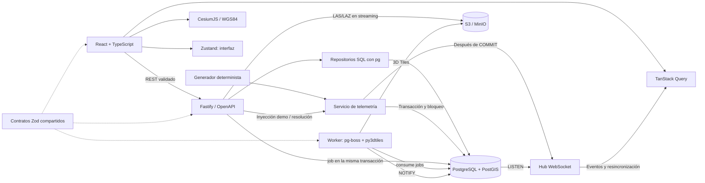

# Arquitectura y decisiones



## Límites de módulos

`packages/shared` contiene contratos y tipos, sin acceso a bases de datos ni componentes. La API separa configuración, pool/migraciones, repositorio, servicio transaccional, transporte HTTP, hub y generador. React usa hooks de consulta para datos del servidor, componentes por feature y un store exclusivo de navegación, selección y conexión.

Los controladores validan con Zod y delegan. El repositorio solo accede a PostgreSQL mediante parámetros. El servicio maneja la operación de negocio que requiere varias escrituras. El simulador no conoce Fastify ni componentes React. La UI no tiene activos ni lecturas incrustadas: todo procede de los seeds y la API.

## Persistencia

Organización → instalaciones → activos → sensores → lecturas. Cada alerta pertenece a un activo y opcionalmente a un sensor; las incidencias manuales no inventan un sensor. FKs compuestas verifican que instalación/organización y sensor/activo correspondan. UUIDs para recursos; identidad bigint para lecturas. Timestamps `timestamptz`, puntos `geometry(Point,4326)`, umbrales ascendentes y estados restringidos con CHECK.

`001_initial.sql` crea tablas y GiST de geometría y de la expresión `location::geography`. El segundo coincide con la expresión de proximidad para evitar confundir grados con metros. El histórico se lee por sensor con el índice único `(sensor_id, recorded_at)`, recorrido hacia atrás para obtener las últimas lecturas; `002` elimina un índice duplicado de esas mismas columnas. Índices de activo/estado y estado/tiempo apoyan la gestión de alertas. `003` añade `alerts.resolved_by` (`operator` o `auto_recovery`) y `004` la región de la organización, que la interfaz muestra en lugar de nombres de lugar fijos en el código.

`schema_migrations` guarda nombre, checksum SHA-256 y fecha. Un advisory lock transaccional impide aplicar migraciones simultáneas; modificar una ya aplicada provoca error. Los cambios posteriores requieren **una nueva migración**, sin editar la anterior. Migraciones y seeds se ejecutan en transacciones; seeds insertan fixtures con IDs deterministas y no reemplazan incidencias ni lecturas existentes.

## Consistencia de telemetría

La fila `telemetry_state` guarda la secuencia y se bloquea con `FOR UPDATE`. Tick, inyección demo, creación manual y resolución comparten ese bloqueo: evita carreras de escritura y es suficiente para este volumen demo. Se incrementa la secuencia, se calculan lecturas deterministas, se persisten, se detectan umbrales y se recalcula el estado de los activos dentro de la misma transacción.

El tick trabaja por lotes: un `INSERT ... SELECT unnest(...)` para todas las lecturas, una sentencia que abre o escala alertas y un único recálculo de estado para todos los activos afectados. Son entre 9 y 12 sentencias por tick, sin depender del número de sensores (antes eran al menos tres por sensor). Las marcas de tiempo salen de `clock_timestamp()` leído **después** de obtener el bloqueo, no de `now()` (inicio de la transacción, antes de esperar), para que el orden temporal coincida con el de confirmación.

El índice único parcial sobre sensor con alerta activa protege la deduplicación en la base, incluso ante solicitudes concurrentes. Una advertencia que alcanza el umbral crítico se escala sobre la misma alerta. Su evento `alert:created` representa también esa actualización; los consumidores invalidan la caché y recuperan la entidad vigente.

Se publica **solo tras COMMIT**. Si el proceso cae entre COMMIT y emisión, REST y la resincronización recuperan el estado; no existe entrega garantizada de cada evento. Un outbox sería necesario para consumidores que exijan entrega durable. No se añade infraestructura que la demo no necesita.

Las alertas inyectadas y las manuales quedan enclavadas hasta intervención. Las anomalías **naturales** del simulador (sin override) se cierran solas en cuanto la lectura vuelve al rango normal, con `resolved_by = auto_recovery`; así una demo que lleva horas encendida no acaba con toda la red en rojo. `resolve` es idempotente: si ya está resuelta conserva la misma fecha. Para anomalías simuladas elimina su override y añade una lectura basal; otras alertas activas del mismo activo siguen condicionando la salud. Estado: crítico si existe cualquier incidencia crítica activa, advertencia si quedan advertencias, operativo en caso contrario.

## Realtime en navegador

Los eventos se agrupan en ventanas de 200 ms y se aplican a la caché de TanStack Query sin peticiones: `sensor:reading` actualiza la última lectura del sensor y añade el punto al histórico del inspector; `asset:status_changed` y `asset:updated` (renombrado) modifican listas, resultados de proximidad y detalle. Solo los eventos de alerta invalidan las consultas de alertas y resumen, que se recargan por REST. Las consultas geográficas conservan los datos previos mientras recargan (`keepPreviousData`). En reconexión (`sync:required`) se consulta REST para recuperar eventos perdidos; foco de ventana y polling de 30 s ofrecen recuperación adicional.

La retención (`READINGS_RETENTION_HOURS`, 24 h en la demo) borra al arrancar y cada 10 minutos las lecturas antiguas, por sensor y en lotes acotados, fuera del bloqueo de telemetría. WebSocket usa espera exponencial con jitter hasta 30 s, ping/pong y límite de backpressure en servidor.

El hub es de un proceso. La plantilla AWS mantiene una réplica. Los eventos de capas LiDAR ya llegan a todas las réplicas por `LISTEN/NOTIFY` (ver más abajo); la telemetría simulada todavía no: varias APIs requerirían llevar también esos eventos por NOTIFY y tener un único productor del simulador.

## Capas LiDAR: subida, cola, worker y 3D Tiles

Una nube de puntos real (una hoja PNOA-LiDAR de 1 × 1 km pesa 40-70 MB en LAZ y tiene unos 10-15 millones de puntos) no se puede convertir dentro de una petición HTTP. El flujo separa la recepción del fichero, la cola y la conversión:

```text
navegador ──multipart──▶ nginx (160 MB, sin buffer) ──▶ API Fastify
                                                       │ 1. comprueba la firma LASF en la cabecera
                                                       │ 2. sube a S3/MinIO en streaming (partes de 8 MB)
                                                       │    calculando SHA-256 y tamaño por el camino
                                                       │ 3. 409 si el SHA-256 ya existe
                                                       │ 4. una transacción: INSERT layers + job pg-boss + NOTIFY
                                                       ▼
                         PostgreSQL ── esquema pgboss (cola) ── tabla layers ── canal NOTIFY geotwin_events
                                                       ▲                              │
                                     estado y NOTIFY   │                              │ LISTEN (cada réplica de API)
                                                       │                              ▼
worker (proceso y contenedor aparte) ──────────────────┘                     hub WebSocket ──▶ navegadores
  1. descarga el origen a una carpeta temporal               layer:progress / layer:ready / layer:failed
  2. geotwin_lidar.py inspect  (laspy: cabecera, CRS, clases, alturas; lectura completa)
  3. decide la corrección vertical (geoide)
  4. geotwin_lidar.py convert  (py3dtiles: EPSG:25830 → EPSG:4978, .pnts con RGB y clasificación)
  5. sube layers/<id>/tiles/<job>/… a S3/MinIO y marca la capa como lista
```

**Almacenamiento.** `packages/storage` define una interfaz pequeña (`put` en streaming, `get`, `head`, `list`, `deletePrefix`…) con dos drivers: carpeta local (desarrollo y tests) y S3 (`@aws-sdk/client-s3` y `lib-storage`), que funciona igual contra AWS S3 y MinIO. Lo elige `STORAGE_DRIVER`. Las claves se validan antes de llegar al driver: segmentos `[A-Za-z0-9._-]`, sin `..`, sin rutas absolutas. Todo lo de una capa vive bajo `layers/<id>/`: el original en `source` y las teselas en `tiles/<id del job>/`. Compose levanta MinIO y la API y el worker crean el bucket si falta (`S3_CREATE_BUCKET`); en AWS el bucket lo crea la infraestructura y la variable queda en `false`.

**Subida.** La API no guarda el fichero en memoria ni en disco: el stream multipart pasa por un `Transform` que retiene solo los primeros 227 bytes hasta validar la cabecera LAS (firma `LASF`, versión 1.0-1.4, formato de punto 0-10; el bit 7 indica LAZ), y después deja pasar los datos calculando SHA-256 y tamaño. Si el tipo no es LAS/LAZ responde 415 sin haber escrito nada; si supera `LAYER_UPLOAD_MAX_BYTES` (150 MiB por defecto) responde 413, antes de leer el cuerpo cuando lo indica `Content-Length` y a mitad de subida cuando llega troceado. En ambos casos cierra la conexión, porque el resto del cuerpo no se ha leído. La extensión del fichero no se usa para nada.

**Transacción y cola.** La fila de la capa, el job de pg-boss y la notificación `created` se escriben en la misma transacción (pg-boss acepta la conexión de la transacción en `send`): no puede quedar una capa sin job ni un job sin capa. pg-boss usa el mismo PostgreSQL, así que no hace falta Redis; el equivalente en AWS sería SQS, con la misma forma de trabajo.

**Worker.** `apps/worker` es un proceso Node aparte (y un servicio de Compose con su propia imagen, que incluye Python, laspy con lazrs, pyproj y py3dtiles fijados en `requirements.txt`). Consume la cola de uno en uno (`WORKER_CONCURRENCY`) y llama a `geotwin_lidar.py`, que escribe una línea JSON por evento (`progress`, `result`, `error`). Cada estado se guarda con una sola sentencia que actualiza la fila y hace `pg_notify` con los valores de esa fila.

- **Reintentos.** Los errores inesperados (almacenamiento, un fallo del conversor) se relanzan y pg-boss reintenta con espera exponencial (`retryLimit` 2, desde 30 s y hasta 10 min); solo el último intento marca la capa como `failed`. Los errores del fichero (LAZ truncado o dañado, CRS que no encaja, cero puntos) fallan a la primera con un mensaje legible: reintentarlos no los arregla.
- **Timeout y caídas.** El job tiene un tiempo máximo (`LAYER_JOB_TIMEOUT_SECONDS`, 30 min) y latido cada 60 s: si el worker muere, pg-boss lo detecta y reintenta. Al expirar o cancelarse el job, la señal de abortar mata el proceso Python (SIGTERM y, a los 5 s, SIGKILL).
- **Idempotencia.** Un job sobre una capa ya `ready` no hace nada. Cada intento empieza desde el original en una carpeta temporal nueva, que se borra siempre, y vacía su carpeta de teselas antes de subir. `POST /api/layers/:id/reprocess` vuelve a encolar una capa terminada; al acabar se borran las teselas de la ejecución anterior.
- **Borrado concurrente.** Si la capa se borra mientras se procesa, la siguiente actualización de progreso no encuentra la fila: el worker aborta el conversor y borra lo que hubiera subido.

**Tiempo real entre procesos.** El worker no comparte memoria con la API: publica con `NOTIFY geotwin_events` y cada API escucha con una conexión dedicada (`LISTEN`) y reenvía a sus WebSockets. Esto resuelve también el reparto entre varias réplicas de API para estos eventos. Las notificaciones perdidas durante una reconexión no se recuperan, así que al reconectar se envía `sync:required` a los clientes. La telemetría simulada sigue publicándose en memoria desde la API, como antes.

**Teselas.** `GET /api/layers/:id/tiles/*` sirve desde el almacenamiento en streaming, con `Content-Type` por extensión, `ETag` (304 con `If-None-Match`) y `Cache-Control: public, max-age=31536000, immutable`. Es seguro porque la ruta incluye el id del job: si la capa se reprocesa, cambia la URL. En producción, estas rutas se podrían servir desde CloudFront delante del bucket.

**Error conocido y corregido.** Con LAZ de más de un bloque (50.000 puntos) la conversión se quedaba colgada: py3dtiles lee la cabecera en el proceso padre y luego hace `fork()`, y el backend paralelo de lazrs (un pool de hilos Rayon) no sobrevive a `fork()`. El worker fuerza el backend de un solo hilo; cada proceso de py3dtiles ya descomprime su parte. Hay un test de regresión con 120.000 puntos.

### Datum vertical: de altitudes ortométricas a elipsoidales

PNOA-LiDAR da altitudes **ortométricas** H (sobre el geoide, red REDNAP, EPSG:5782 «Alicante height»). Cesium y las coordenadas geocéntricas EPSG:4978 trabajan con alturas **elipsoidales** h (sobre GRS80/WGS84). La relación es h = H + N, donde N es la ondulación del geoide. En Valladolid N vale unos +53 m: sin corregir, la nube aparece 53 m por debajo de su sitio (el terreno de Cesium y los edificios quedarían flotando sobre ella).

El worker elige el método en este orden y lo guarda en la capa (`geoid_method`, `geoid_offset_m`):

| Método              | Cuándo                                                                             | Cómo                                                                                                                                    |
| ------------------- | ---------------------------------------------------------------------------------- | --------------------------------------------------------------------------------------------------------------------------------------- |
| `none`              | El origen ya es elipsoidal (`vertical_datum=ellipsoidal`)                          | Nada                                                                                                                                    |
| `override`          | `geoid_offset_m` en la subida o en `reprocess`; si no, `GEOID_OFFSET_M` del worker | Constante                                                                                                                               |
| `egm08_rednap_grid` | Existe `es_ign_egm08-rednap.tif` en `GEOID_GRID_DIR`                               | **Por punto**: PROJ transforma `EPSG:25830+5782 → EPSG:4978` con la rejilla oficial del IGN                                             |
| `egm96_centre`      | En cualquier otro caso                                                             | Constante: N de EGM96 en el centro de la hoja, del paquete npm `egm96-universal` (MIT; EGM96 es un modelo de la NGA de dominio público) |

La corrección constante no reescribe puntos: suma N al _offset_ Z de la cabecera LAS (Z = entero × escala + offset), una operación O(1) incluso con 15 millones de puntos comprimidos. Los datos del LAZ no dependen de ese offset.

Por qué basta una constante por hoja, y cuánto se equivoca (medido con PROJ 9 y las rejillas oficiales, `us_nga_egm96_15.tif` y `es_ign_egm08-rednap.tif`):

| Fuente de error                                                                 | Magnitud                            |
| ------------------------------------------------------------------------------- | ----------------------------------- |
| Variación de N (EGM08-REDNAP) dentro de una hoja de 1 × 1 km en Laguna de Duero | ≤ 1,6 cm respecto al centro         |
| EGM96 frente a EGM08-REDNAP en Laguna de Duero (N = 53,60 m frente a 53,11 m)   | +0,49 a +0,50 m                     |
| EGM96 frente a EGM08-REDNAP en la provincia de Valladolid                       | +0,06 a +0,93 m (media +0,39 m)     |
| EGM96 frente a EGM08-REDNAP en la España peninsular (rejilla de 0,1°)           | −1,2 a +1,5 m; percentil 95: 0,79 m |
| Interpolación del paquete npm frente a la rejilla EGM96 de PROJ                 | 1 mm                                |

Es decir: sin la rejilla oficial, la nube de Laguna de Duero queda medio metro alta, con un error casi constante en toda la hoja (por debajo del metro en la provincia). Es suficiente para visualizar, no para medir alturas absolutas; con la rejilla oficial instalada el error de modelo desaparece y PROJ aplica N punto a punto. La rejilla (CC-BY 4.0, IGN) no se incluye en el repositorio: se descarga de `cdn.proj.org` (ver README).

Una trampa: si falta la rejilla, PROJ no falla, sino que usa una transformación «ballpark» con N = 0 y la nube se hunde 53 m. Por eso el worker no se fía del CRS compuesto: comprueba que PROJ devuelve en el centro el mismo N que una lectura directa de la rejilla, y desactiva la red de PROJ (`PROJ_NETWORK=OFF`) para que el resultado no dependa de la conectividad. ETRS89 y WGS84 se tratan como iguales; hoy difieren en menos de 1 m en planta, irrelevante para visualizar.

## Cesium

React crea y destruye Viewer y manejadores para evitar fugas y contextos WebGL acumulados. El visor nunca depende del estado de las consultas: cambiar de instalación no lo desmonta, así que se conservan la capa base, el relieve y los edificios. Assets son entidades reales del motor, actualizadas sin reconstruir el visor. La cámara encuadra una esfera que contiene los activos y las instalaciones visibles; la distancia se calcula con el campo de visión del eje más estrecho, que en un móvil vertical es el horizontal. El picking al mover el ratón se limita a uno por fotograma y el tooltip se mueve por DOM, sin renderizar React. Los colores proceden del mismo estado REST que usa el inspector. La selección geoespacial usa `scene.pick`, y la selección desde lista comparte el mismo ID de interfaz.

PNOA y el globo elipsoidal no invocan ion. La capa Natural Earth local da continuidad básica sin red. Buildings se activa junto con Cesium World Terrain, con token y errores visibles. Si falla la lectura del terreno, no se añade el tileset de edificios sobre el elipsoide. Activos y etiquetas usan CLAMP_TO_TERRAIN; las áreas se clasifican sobre el terreno. Se conserva la elevación original del tileset OSM, sin traslaciones artificiales. Se conservan créditos cartográficos. Integración de recursos basada en la [documentación oficial de Cesium](https://cesium.com/blog/2024/02/13/configuring-vite-or-webpack-for-cesiumjs/); consulta espacial según [ST_DWithin](https://postgis.net/docs/ST_DWithin.html).

## Por qué estas decisiones

- Monolito modular: menos operación y transacciones directas para un MVP de alcance acotado.
- SQL y pg: hace visibles las consultas, índices y capacidades de PostGIS, sin ORM que las oculte.
- Zod + type provider: fuente común de validación, tipos y documentación.
- Sin autenticación aparente: organización única declarada; P1 exige seguridad real.
- Sin Redis, Kubernetes ni microservicios: no hay un requisito probado que los justifique. La cola de conversiones usa pg-boss sobre el mismo PostgreSQL.
- Un worker aparte para las conversiones: la CPU y la memoria de py3dtiles no compiten con las peticiones de la API, y escala de forma independiente.
- Python solo para lo geoespacial pesado (laspy, pyproj, py3dtiles), detrás de un protocolo de líneas JSON; la orquestación, los reintentos y el estado siguen en TypeScript.
- shadcn/ui: componentes Button y Dialog mantenidos en el repositorio, basados en Radix, cva y Tailwind; accesibilidad del diálogo y variantes coherentes.
