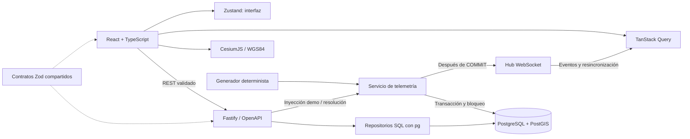

# Arquitectura y decisiones

## Límites de módulos

`packages/shared` contiene contratos y tipos, sin acceso a bases de datos ni componentes. La API separa configuración, pool/migraciones, repositorio, servicio transaccional, transporte HTTP, hub y generador. React usa hooks de consulta para datos del servidor, componentes por feature y un store exclusivo de navegación, selección y conexión.

Los controladores validan con Zod y delegan. El repositorio solo accede a PostgreSQL mediante parámetros. El servicio maneja la operación de negocio que requiere varias escrituras. El simulador no conoce Fastify ni componentes React. La UI no tiene activos ni lecturas incrustadas: todo procede de los seeds y la API.

## Persistencia

Organización → instalaciones → activos → sensores → lecturas. Cada alerta pertenece a un activo y opcionalmente a un sensor; las incidencias manuales no inventan un sensor. FKs compuestas verifican que instalación/organización y sensor/activo correspondan. UUIDs para recursos; identidad bigint para lecturas. Timestamps `timestamptz`, puntos `geometry(Point,4326)`, umbrales ascendentes y estados restringidos con CHECK.

`001_initial.sql` crea tablas y GiST de geometría y de la expresión `location::geography`. El segundo coincide con la expresión de proximidad para evitar confundir grados con metros. Las búsquedas de histórico usan `(sensor_id, recorded_at DESC)`. Índices de activo/estado y estado/tiempo apoyan la gestión de alertas.

`schema_migrations` guarda nombre, checksum SHA-256 y fecha. Un advisory lock transaccional impide aplicar migraciones simultáneas; modificar una ya aplicada provoca error. Los cambios posteriores requieren **una nueva migración**, sin editar la anterior. Migraciones y seeds se ejecutan en transacciones; seeds insertan fixtures con IDs deterministas y no reemplazan incidencias ni lecturas existentes.

## Consistencia de telemetría

La fila `telemetry_state` guarda la secuencia y se bloquea con `FOR UPDATE`. Tick, inyección demo, creación manual y resolución comparten ese bloqueo: evita carreras de escritura y es suficiente para este volumen demo. Se incrementa la secuencia, se calculan lecturas deterministas, se persisten, se detectan umbrales y se recalcula el estado del activo dentro de la misma transacción.

El índice único parcial sobre sensor con alerta activa protege la deduplicación en la base, incluso ante solicitudes concurrentes. Una advertencia que alcanza el umbral crítico se escala sobre la misma alerta. Su evento `alert:created` representa también esa actualización; los consumidores invalidan la caché y recuperan la entidad vigente.

Se publica **solo tras COMMIT**. Si el proceso cae entre COMMIT y emisión, REST y la resincronización recuperan el estado; no existe entrega garantizada de cada evento. Un outbox sería necesario para consumidores que exijan entrega durable. No se añade infraestructura que la demo no necesita.

Las alertas quedan enclavadas hasta intervención. `resolve` es idempotente: si ya está resuelta conserva la misma fecha. Para anomalías simuladas elimina su override y añade una lectura basal; otras alertas activas del mismo activo siguen condicionando la salud. Estado: crítico si existe cualquier incidencia crítica activa, advertencia si quedan advertencias, operativo en caso contrario.

## Realtime en navegador

Eventos de lecturas y cambios invalidan consultas `geo` agrupados en ventanas de 200 ms para que un tick de 36 sensores no provoque 36 recargas. TanStack Query aplica structural sharing y conserva datos durante refetch. En reconexión se consulta REST para recuperar eventos perdidos; foco de ventana y polling de 30 s ofrecen recuperación adicional. WebSocket usa espera exponencial con jitter hasta 30 s, ping/pong y límite de backpressure en servidor.

El hub es de un proceso. La plantilla AWS mantiene una réplica. Varias APIs con hubs separados requerirían una estrategia de difusión y un único productor, incluso si el bloqueo SQL protege las escrituras.

## Cesium

React crea y destruye Viewer y manejadores para evitar fugas y contextos WebGL acumulados. Assets son entidades reales del motor, actualizadas sin reconstruir el visor. Los colores proceden del mismo estado REST que usa el inspector. La selección geoespacial usa `scene.pick`, y la selección desde lista comparte el mismo ID de interfaz.

PNOA y el globo elipsoidal no invocan ion. La capa Natural Earth local da continuidad básica sin red. Buildings se activa junto con Cesium World Terrain, con token y errores visibles. Si falla la lectura del terreno, no se añade el tileset de edificios sobre el elipsoide. Activos y etiquetas usan CLAMP_TO_TERRAIN; las áreas se clasifican sobre el terreno. Se conserva la elevación original del tileset OSM, sin traslaciones artificiales. Se conservan créditos cartográficos. Integración de recursos basada en la [documentación oficial de Cesium](https://cesium.com/blog/2024/02/13/configuring-vite-or-webpack-for-cesiumjs/); consulta espacial según [ST_DWithin](https://postgis.net/docs/ST_DWithin.html).

## Por qué estas decisiones

- Monolito modular: menos operación y transacciones directas para un MVP de 72 horas.
- SQL y pg: hace visibles las consultas, índices y capacidades de PostGIS, sin ORM que las oculte.
- Zod + type provider: fuente común de validación, tipos y documentación.
- Sin autenticación aparente: organización única declarada; P1 exige seguridad real.
- Sin Redis, Kubernetes ni microservicios: no hay un requisito probado que los justifique.
- shadcn/ui: componentes Button y Dialog mantenidos en el repositorio, basados en Radix, cva y Tailwind; accesibilidad del diálogo y variantes coherentes.
