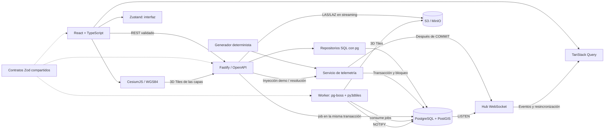
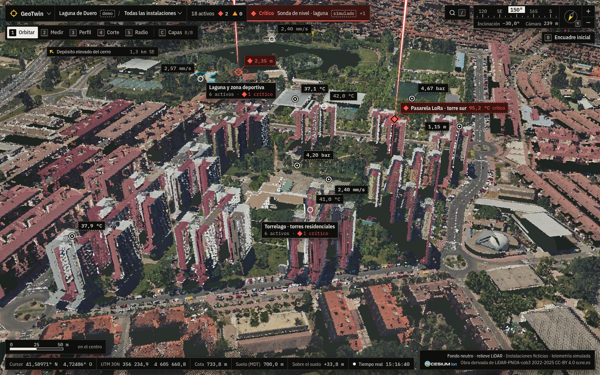

# Arquitectura y decisiones



## Límites de módulos

`packages/shared` contiene contratos y tipos, sin acceso a bases de datos ni componentes. La API separa configuración, pool/migraciones, repositorio, servicio transaccional, transporte HTTP, hub y generador. React usa hooks de consulta para datos del servidor, componentes por feature y un store exclusivo de navegación, selección y conexión. Vista, instalación y activo seleccionados se reflejan en la URL (`/gemelo?instalacion=…&activo=…`) sin librería de enrutado: un cambio de vista añade una entrada al historial y elegir instalación o activo la reemplaza; nginx y Vite sirven `index.html` para cualquier ruta.

Los controladores validan con Zod y delegan. El repositorio solo accede a PostgreSQL mediante parámetros. El servicio maneja la operación de negocio que requiere varias escrituras. El simulador no conoce Fastify ni componentes React. La UI no tiene activos ni lecturas incrustadas: todo procede de los seeds y la API.

## Persistencia

Organización → instalaciones → activos → sensores → lecturas. Cada alerta pertenece a un activo y opcionalmente a un sensor; las incidencias manuales no inventan un sensor. FKs compuestas verifican que instalación/organización y sensor/activo correspondan. UUIDs para recursos; identidad bigint para lecturas. Timestamps `timestamptz`, puntos `geometry(Point,4326)`, umbrales ascendentes y estados restringidos con CHECK.

`001_initial.sql` crea tablas y GiST de geometría y de la expresión `location::geography`. El segundo coincide con la expresión de proximidad para evitar confundir grados con metros. El histórico se lee por sensor con el índice único `(sensor_id, recorded_at)`, recorrido hacia atrás para obtener las últimas lecturas; `002` elimina un índice duplicado de esas mismas columnas. Índices de activo/estado y estado/tiempo apoyan la gestión de alertas. `003` añade `alerts.resolved_by` (`operator` o `auto_recovery`), `009` `alerts.acknowledged_at` («Reconocer») y `004` la región de la organización, que la interfaz muestra en lugar de nombres de lugar fijos en el código.

`schema_migrations` guarda nombre, checksum SHA-256 y fecha. Un advisory lock transaccional impide aplicar migraciones simultáneas; modificar una ya aplicada provoca error. Los cambios posteriores requieren **una nueva migración**, sin editar la anterior. Migraciones y seeds se ejecutan en transacciones; seeds insertan fixtures con IDs deterministas y no reemplazan incidencias ni lecturas existentes.

## Consistencia de telemetría

La fila `telemetry_state` guarda la secuencia y se bloquea con `FOR UPDATE`. Tick, inyección demo, creación manual y resolución comparten ese bloqueo: evita carreras de escritura y es suficiente para este volumen demo. Se incrementa la secuencia, se calculan lecturas deterministas, se persisten, se detectan umbrales y se recalcula el estado de los activos dentro de la misma transacción.

El tick trabaja por lotes: un `INSERT ... SELECT unnest(...)` para todas las lecturas, una sentencia que abre o escala alertas y un único recálculo de estado para todos los activos afectados. Son entre 9 y 12 sentencias por tick, sin depender del número de sensores (antes eran al menos tres por sensor). Las marcas de tiempo salen de `clock_timestamp()` leído **después** de obtener el bloqueo, no de `now()` (inicio de la transacción, antes de esperar), para que el orden temporal coincida con el de confirmación.

El índice único parcial sobre sensor con alerta activa protege la deduplicación en la base, incluso ante solicitudes concurrentes. Una advertencia que alcanza el umbral crítico se escala sobre la misma alerta. Ese escalado se publica como `alert:updated` (una alerta nueva es `alert:created`); los consumidores invalidan la caché y recuperan la entidad vigente.

Se publica **solo tras COMMIT**. Si el proceso cae entre COMMIT y emisión, REST y la resincronización recuperan el estado; no existe entrega garantizada de cada evento. Un outbox sería necesario para consumidores que exijan entrega durable. No se añade infraestructura que la demo no necesita.

Las alertas inyectadas y las manuales quedan enclavadas hasta intervención. Las anomalías **naturales** del simulador (sin override) se cierran solas en cuanto la lectura vuelve al rango normal, con `resolved_by = auto_recovery`; así una demo que lleva horas encendida no acaba con toda la red en rojo. `resolve` es idempotente: si ya está resuelta conserva la misma fecha. Para anomalías simuladas elimina su override y añade una lectura basal; otras alertas activas del mismo activo siguen condicionando la salud. Estado: crítico si existe cualquier incidencia crítica activa, advertencia si quedan advertencias, operativo en caso contrario.

## Realtime en navegador

Los eventos se agrupan en ventanas de 200 ms y se aplican a la caché de TanStack Query sin peticiones: `sensor:reading` actualiza la última lectura del sensor y añade el punto al histórico del inspector; `asset:status_changed` y `asset:updated` (renombrado) modifican listas, resultados de proximidad y detalle. Solo los eventos de alerta invalidan las consultas de alertas y resumen, que se recargan por REST. Las consultas geográficas conservan los datos previos mientras recargan (`keepPreviousData`). En reconexión (`sync:required`) se consulta REST para recuperar eventos perdidos; foco de ventana y polling de 30 s ofrecen recuperación adicional.

La retención (`READINGS_RETENTION_HOURS`, 24 h en la demo) borra al arrancar y cada 10 minutos las lecturas antiguas, por sensor y en lotes acotados, fuera del bloqueo de telemetría. WebSocket usa espera exponencial con jitter hasta 30 s, ping/pong y límite de backpressure en servidor.

El hub es de un proceso. La plantilla AWS mantiene una réplica. Los eventos de capas LiDAR ya llegan a todas las réplicas por `LISTEN/NOTIFY` (ver más abajo); la telemetría simulada todavía no: varias APIs requerirían llevar también esos eventos por NOTIFY y tener un único productor del simulador.

## Capas LiDAR: subida, cola, worker y 3D Tiles

Una nube de puntos real (una hoja PNOA-LiDAR de 1 × 1 km pesa 40-70 MB en LAZ y tiene unos 10-15 millones de puntos) no se puede convertir dentro de una petición HTTP. El flujo separa la recepción del fichero, la cola y la conversión:

```text
navegador ──multipart──▶ nginx (160 MB, sin buffer) ──▶ API Fastify
                                                       │ 1. comprueba la firma LASF en la cabecera
                                                       │ 2. sube a S3/MinIO en streaming (partes de 8 MB)
                                                       │    calculando SHA-256 y tamaño por el camino
                                                       │ 3. 409 si el SHA-256 ya existe
                                                       │ 4. una transacción: INSERT layers + job pg-boss + NOTIFY
                                                       ▼
                         PostgreSQL ── esquema pgboss (cola) ── tabla layers ── canal NOTIFY geotwin_events
                                                       ▲                              │
                                     estado y NOTIFY   │                              │ LISTEN (cada réplica de API)
                                                       │                              ▼
worker (proceso y contenedor aparte) ──────────────────┘                     hub WebSocket ──▶ navegadores
  1. descarga el origen a una carpeta temporal               layer:progress / layer:ready / layer:failed
  2. geotwin_lidar.py inspect  (laspy: cabecera, CRS, clases, alturas; lectura completa)
  3. decide la corrección vertical (geoide)
  4. geotwin_lidar.py convert  (una pasada: quita solape y ruido y promedia el suelo en un MDT de 2 m;
                                py3dtiles: EPSG:25830 → EPSG:4978, .pnts con RGB y clasificación;
                                MDT a alturas elipsoidales en terrain/dtm.json + dtm.bin)
  5. sube layers/<id>/tiles/<job>/… a S3/MinIO y marca la capa como lista
```

**Almacenamiento.** `packages/storage` define una interfaz pequeña (`put` en streaming, `get`, `head`, `list`, `deletePrefix`…) con dos drivers: carpeta local (desarrollo y tests) y S3 (`@aws-sdk/client-s3` y `lib-storage`), que funciona igual contra AWS S3 y MinIO. Lo elige `STORAGE_DRIVER`. Las claves se validan antes de llegar al driver: segmentos `[A-Za-z0-9._-]`, sin `..`, sin rutas absolutas. Todo lo de una capa vive bajo `layers/<id>/`: el original en `source` y las teselas en `tiles/<id del job>/`. Compose levanta MinIO y la API y el worker crean el bucket si falta (`S3_CREATE_BUCKET`); en AWS el bucket lo crea la infraestructura y la variable queda en `false`.

**Subida.** La API no guarda el fichero en memoria ni en disco: el stream multipart pasa por un `Transform` que retiene solo los primeros 227 bytes hasta validar la cabecera LAS (firma `LASF`, versión 1.0-1.4, formato de punto 0-10; el bit 7 indica LAZ), y después deja pasar los datos calculando SHA-256 y tamaño. Si el tipo no es LAS/LAZ responde 415 sin haber escrito nada; si supera `LAYER_UPLOAD_MAX_BYTES` (150 MiB por defecto) responde 413, antes de leer el cuerpo cuando lo indica `Content-Length` y a mitad de subida cuando llega troceado. En ambos casos cierra la conexión, porque el resto del cuerpo no se ha leído. La extensión del fichero no se usa para nada.

**Transacción y cola.** La fila de la capa, el job de pg-boss y la notificación `created` se escriben en la misma transacción (pg-boss acepta la conexión de la transacción en `send`): no puede quedar una capa sin job ni un job sin capa. pg-boss usa el mismo PostgreSQL, así que no hace falta Redis; el equivalente en AWS sería SQS, con la misma forma de trabajo.

**Worker.** `apps/worker` es un proceso Node aparte (y un servicio de Compose con su propia imagen, que incluye Python, laspy con lazrs, pyproj y py3dtiles fijados en `requirements.txt`). Consume la cola de uno en uno (`WORKER_CONCURRENCY`) y llama a `geotwin_lidar.py`, que escribe una línea JSON por evento (`progress`, `result`, `error`). Cada estado se guarda con una sola sentencia que actualiza la fila y hace `pg_notify` con los valores de esa fila.

- **Reintentos.** Los errores inesperados (almacenamiento, un fallo del conversor) se relanzan y pg-boss reintenta con espera exponencial (`retryLimit` 2, desde 30 s y hasta 10 min); solo el último intento marca la capa como `failed`. Los errores del fichero (LAZ truncado o dañado, CRS que no encaja, cero puntos) fallan a la primera con un mensaje legible: reintentarlos no los arregla.
- **Timeout y caídas.** El job tiene un tiempo máximo (`LAYER_JOB_TIMEOUT_SECONDS`, 30 min) y latido cada 60 s: si el worker muere, pg-boss lo detecta y reintenta. Al expirar o cancelarse el job, la señal de abortar mata el proceso Python (SIGTERM y, a los 5 s, SIGKILL).
- **Idempotencia.** Un job sobre una capa ya `ready` no hace nada. Cada intento empieza desde el original en una carpeta temporal nueva, que se borra siempre, y vacía su carpeta de teselas antes de subir. `POST /api/layers/:id/reprocess` vuelve a encolar una capa terminada; al acabar se borran las teselas de la ejecución anterior.
- **Borrado concurrente.** Si la capa se borra mientras se procesa, la siguiente actualización de progreso no encuentra la fila: el worker aborta el conversor y borra lo que hubiera subido.

**Tiempo real entre procesos.** El worker no comparte memoria con la API: publica con `NOTIFY geotwin_events` y cada API escucha con una conexión dedicada (`LISTEN`) y reenvía a sus WebSockets. Esto resuelve también el reparto entre varias réplicas de API para estos eventos. Las notificaciones perdidas durante una reconexión no se recuperan, así que al reconectar se envía `sync:required` a los clientes. La telemetría simulada sigue publicándose en memoria desde la API, como antes.

**Teselas.** `GET /api/layers/:id/tiles/*` sirve desde el almacenamiento en streaming, con `Content-Type` por extensión, `ETag` (304 con `If-None-Match`) y `Cache-Control: public, max-age=31536000, immutable`. Es seguro porque la ruta incluye el id del job: si la capa se reprocesa, cambia la URL. En producción, estas rutas se podrían servir desde CloudFront delante del bucket.

**Clases que no se dibujan.** Las hojas reales de PNOA-LiDAR (3.ª cobertura, LAS 1.4 formato 8: RGB de 16 bits e infrarrojo) marcan como clase 12 los puntos de **solape** entre pasadas: en Laguna de Duero son entre el 0 y el 32 % de cada hoja (15,9 de 63,6 millones en las ocho). Duplican superficie ya cubierta por la otra pasada y, en el modo Clasificación, pintaban franjas grises. El worker los quita, junto con el ruido (7 y 18), en la misma pasada en la que lee el suelo: copia los puntos que se quedan a un LAZ temporal (5 s por hoja con el backend paralelo de lazrs, antes del `fork()` de py3dtiles) y py3dtiles convierte esa copia. `LIDAR_EXCLUDE_CLASSES` cambia la lista; la capa guarda cuántos puntos y de qué clases se quitaron (`excluded`). El infrarrojo no llega a las teselas (py3dtiles guarda posición, RGB y clasificación) y el color de 16 bits se pasa a 8 dividiendo entre 256.

**Modelo del terreno (MDT).** En esa misma pasada se promedian las alturas de la clase 2 (suelo) en una malla de 2 m (`DTM_CELL_M`) en el CRS de origen, alineada a múltiplos de la celda para que las hojas vecinas casen. Los huecos (edificios, la laguna sin retornos, sombras) se rellenan por _pull-push_: una pirámide de medias de 2 × 2 celdas válidas cuyos niveles gruesos, interpolados bilinealmente, tapan los huecos del nivel fino sin tocar las celdas medidas. Después la malla se remuestrea a una rejilla regular de longitud y latitud (un nodo por celda, unos 511 × 511 por hoja), se le aplica la misma corrección de geoide que a los puntos (por nodo con la rejilla oficial) y se guarda junto a las teselas: `terrain/dtm.json` (`dtmMetaSchema` en `packages/shared`: límites, huella real de la hoja, escala) y `terrain/dtm.bin` (uint16 en pasos de 1 cm, 0,5 MB). Los nodos fuera del cuadrado UTM de la hoja, que en longitud y latitud queda algo girado, se marcan sin dato para que gane la hoja vecina. En las hojas de Laguna de Duero, el MDT queda a 2 cm de mediana (8-10 cm en el percentil 95) de los puntos de suelo.

**Error conocido y corregido.** Con LAZ de más de un bloque (50.000 puntos) la conversión se quedaba colgada: py3dtiles lee la cabecera en el proceso padre y luego hace `fork()`, y el backend paralelo de lazrs (un pool de hilos Rayon) no sobrevive a `fork()`. El worker fuerza el backend de un solo hilo; cada proceso de py3dtiles ya descomprime su parte. Hay un test de regresión con 120.000 puntos.

### Datum vertical: de altitudes ortométricas a elipsoidales

PNOA-LiDAR da altitudes **ortométricas** H (sobre el geoide, red REDNAP, EPSG:5782 «Alicante height»). Cesium y las coordenadas geocéntricas EPSG:4978 trabajan con alturas **elipsoidales** h (sobre GRS80/WGS84). La relación es h = H + N, donde N es la ondulación del geoide. En Valladolid N vale unos +53 m: sin corregir, la nube aparece 53 m por debajo de su sitio (el terreno de Cesium y los edificios quedarían flotando sobre ella).

El worker elige el método en este orden y lo guarda en la capa (`geoid_method`, `geoid_offset_m`):

| Método              | Cuándo                                                                             | Cómo                                                                                                                                    |
| ------------------- | ---------------------------------------------------------------------------------- | --------------------------------------------------------------------------------------------------------------------------------------- |
| `none`              | El origen ya es elipsoidal (`vertical_datum=ellipsoidal`)                          | Nada                                                                                                                                    |
| `override`          | `geoid_offset_m` en la subida o en `reprocess`; si no, `GEOID_OFFSET_M` del worker | Constante                                                                                                                               |
| `egm08_rednap_grid` | Existe `es_ign_egm08-rednap.tif` en `GEOID_GRID_DIR`                               | **Por punto**: PROJ transforma `EPSG:25830+5782 → EPSG:4978` con la rejilla oficial del IGN                                             |
| `egm96_centre`      | En cualquier otro caso                                                             | Constante: N de EGM96 en el centro de la hoja, del paquete npm `egm96-universal` (MIT; EGM96 es un modelo de la NGA de dominio público) |

La corrección constante no reescribe puntos: suma N al _offset_ Z de la cabecera LAS (Z = entero × escala + offset), una operación O(1) incluso con 15 millones de puntos comprimidos. Los datos del LAZ no dependen de ese offset.

Por qué basta una constante por hoja, y cuánto se equivoca (medido con PROJ 9 y las rejillas oficiales, `us_nga_egm96_15.tif` y `es_ign_egm08-rednap.tif`):

| Fuente de error                                                                 | Magnitud                            |
| ------------------------------------------------------------------------------- | ----------------------------------- |
| Variación de N (EGM08-REDNAP) dentro de una hoja de 1 × 1 km en Laguna de Duero | ≤ 1,6 cm respecto al centro         |
| EGM96 frente a EGM08-REDNAP en Laguna de Duero (N = 53,60 m frente a 53,11 m)   | +0,49 a +0,50 m                     |
| EGM96 frente a EGM08-REDNAP en la provincia de Valladolid                       | +0,06 a +0,93 m (media +0,39 m)     |
| EGM96 frente a EGM08-REDNAP en la España peninsular (rejilla de 0,1°)           | −1,2 a +1,5 m; percentil 95: 0,79 m |
| Interpolación del paquete npm frente a la rejilla EGM96 de PROJ                 | 1 mm                                |

Es decir: sin la rejilla oficial, la nube de Laguna de Duero queda medio metro alta, con un error casi constante en toda la hoja (por debajo del metro en la provincia). Es suficiente para visualizar, no para medir alturas absolutas; con la rejilla oficial instalada el error de modelo desaparece y PROJ aplica N punto a punto. La rejilla (CC-BY 4.0, IGN) no se incluye en el repositorio: se descarga de `cdn.proj.org` (ver README).

Una trampa: si falta la rejilla, PROJ no falla, sino que usa una transformación «ballpark» con N = 0 y la nube se hunde 53 m. Por eso el worker no se fía del CRS compuesto: comprueba que PROJ devuelve en el centro el mismo N que una lectura directa de la rejilla, y desactiva la red de PROJ (`PROJ_NETWORK=OFF`) para que el resultado no dependa de la conectividad. ETRS89 y WGS84 se tratan como iguales; hoy difieren en menos de 1 m en planta, irrelevante para visualizar.

## Cesium

React crea y destruye Viewer y manejadores para evitar fugas y contextos WebGL acumulados. El visor nunca depende del estado de las consultas: cambiar de instalación no lo desmonta, así que se conservan la capa base, el relieve y los edificios. Assets son entidades reales del motor, actualizadas sin reconstruir el visor. La cámara encuadra una esfera que contiene los activos y las instalaciones visibles, con un margen del 30 % (entre 200 y 450 m) para que la red completa conserve sitio para sus etiquetas y una sola instalación llene la vista; la distancia se calcula con el campo de visión del eje más estrecho, que en un móvil vertical es el horizontal. La escena ocupa toda la pantalla y la interfaz flota encima: el encuadre de la red, de una instalación, de un activo y de una capa descuenta lo que tapan las placas en los cuatro bordes (`coveredEdges` en `camera.ts`) y centra la esfera en la parte libre (lo comprueba una prueba E2E a 1280 y 1440 px de ancho). El picking al mover el ratón se limita a uno por fotograma y el tooltip se mueve por DOM, sin renderizar React. Los colores proceden del mismo estado REST que usa el inspector. La selección geoespacial usa `scene.pick`, y la selección desde lista comparte el mismo ID de interfaz.

**Relieve del LiDAR.** Sin Cesium ion el globo es el elipsoide (h = 0) y una nube de Laguna de Duero, a unos 750 m de altura elipsoidal, flotaría sobre el mapa. `features/layers/lidar-terrain-provider.ts` descarga los MDT de las capas listas (una vez por URL, que es inmutable) y monta un `CustomHeightmapTerrainProvider` de 65 × 65 muestras por tesela. Las alturas las calcula `lidar-terrain.ts`, sin Cesium y con pruebas unitarias: dentro de la huella de una hoja, interpolación bilineal de su MDT; fuera, la altura del borde de las hojas cercanas (cada una pesa con el inverso del cuadrado de la distancia a su huella, y deja de contar a 400 m) se funde en 400 m con un plano a la altura mediana de todas (la meseta en torno a Valladolid es casi llana, pero ese plano es un relleno visual, no un dato), y entre 30 y 60 km el plano vuelve al elipsoide. Mezclar varias hojas, y no tomar solo la más cercana, evita un escalón en la diagonal de una muesca cóncava (donde falta una hoja de un cuadrado, como la 355-4604), que es donde cambia cuál está más cerca. El terreno se dibuja 25 cm por debajo del suelo medido para que la superficie lisa no tape los puntos de suelo de la nube. Con este relieve, la ortofoto, los activos (anclados al terreno, a su altura de montaje) y las nubes quedan juntos a su altura real, y la cámara apunta a la altura del terreno. El panel Capas permite apagarlo; si se cargan el terreno y los edificios de ion, se usa el de ion.

**Capa fotorrealista (opcional).** Con `VITE_CESIUM_ION_TOKEN`, el interruptor «Fotorrealista (Google)» de Capas carga Google Photorealistic 3D Tiles con `Cesium3DTileset.fromIonAssetId(2275207, …)` una sola vez y después solo lo muestra u oculta. No usa `createGooglePhotorealistic3DTileset` porque ese atajo guarda la primera respuesta de ion para toda la página, también una fallida, y otro clic tras un fallo no volvería a preguntar; `fromIonAssetId` pregunta cada vez (con las mismas opciones que el atajo). Si la tesela raíz falla, si fallan varias seguidas sin que haya llegado ninguna o si pasan 30 s sin ninguna, la capa se da por fallida: vuelve el globo, sale el mensaje y el tileset se descarta. Mientras está activo se oculta el globo (las teselas ya traen el suelo) y la capa de la ortofoto PNOA con su crédito, los activos usan `RELATIVE_TO_3D_TILE` sin altura de montaje (la malla ya tiene las cubiertas), las áreas se clasifican también sobre 3D Tiles y las nubes mantienen su altura real. La lógica de carga y errores está en `photorealistic.ts`, sin Cesium, con pruebas unitarias; una prueba E2E sustituye la respuesta de ion por una malla local. Detalle, condiciones y prueba manual en [fotorrealista.md](fotorrealista.md).

**Mapa base.** El Viewer no tiene capa base: debajo queda el suelo oscuro del globo (`#1d2420`), el fondo «Neutro». El atlas Natural Earth (incluido en Cesium, sin red) se añade solo si se elige en Capas › Fondo. La ortofoto PNOA va encima, en una sola `ImageryLayer` que se añade una vez y después solo se muestra u oculta (`baseImagery` en el store de capas), así que su caché sobrevive a los cambios. `features/layers/base-imagery.ts` (sin Cesium, con pruebas unitarias) describe las fuentes en orden (`VITE_PNOA_SOURCES`, por defecto `local,idee,ign`): la copia en `/ortho/{z}/{x}/{y}.jpg` (z13-z19, solo el rectángulo de las ocho hojas), el TMS de IDEE (`{reverseY}`, filas desde el sur) y el WMTS del IGN (KVP, `GoogleMapsCompatible`); todas en Web Mercator y hasta z19 (0,22 m/px a esta latitud, la resolución nativa del PNOA). `pnoa-imagery.ts` prueba cada fuente con un `fetch` CORS de la tesela z15 de Torrelago (8 s como máximo; solo vale un 2xx con `content-type: image/*`, lo que descarta la página que Vite o nginx devuelven para `/ortho/` si no existe) y añade la primera que pasa. Un vigilante sobre `errorEvent` corta los reintentos y, ante un 401/403 o 8 teselas fallidas seguidas (un 404 no cuenta: es una tesela fuera de cobertura), quita la capa y prueba las siguientes; sin ninguna, `data-pnoa="error"` en el visor, el fondo pasa a Neutro (`effectiveBase`), un aviso y la etiqueta «Fondo neutro (PNOA no disponible)» en la placa de créditos. En el móvil (calidad Baja) la capa se crea con `maximumLevel` 18. Una CSP futura tendría que permitir los servidores de teselas en `connect-src`, no solo en `img-src`, porque Cesium las pide con XHR.

PNOA y el globo elipsoidal no invocan ion. Buildings se activa junto con Cesium World Terrain, con token y errores visibles. Si falla la lectura del terreno, no se añade el tileset de edificios sobre el elipsoide. Activos y etiquetas usan RELATIVE_TO_TERRAIN con la altura de montaje del activo (`mount_height_m`: 0 a ras de suelo, la cubierta para una pasarela en una torre); las áreas se clasifican sobre el terreno. Se conserva la elevación original del tileset OSM, sin traslaciones artificiales. Se conservan créditos cartográficos. Integración de recursos basada en la [documentación oficial de Cesium](https://cesium.com/blog/2024/02/13/configuring-vite-or-webpack-for-cesiumjs/); consulta espacial según [ST_DWithin](https://postgis.net/docs/ST_DWithin.html).

### Interfaz «Estación total» (HUD)



**Escena y placas.** `App.tsx` es `features/hud/stage.tsx`: el visor (`cesium-view.tsx`, en su chunk diferido) se monta una sola vez a pantalla completa y no se desmonta nunca, ni al abrir una hoja ni al cambiar de instalación o de URL. La página no tiene scroll (`100dvh`). La interfaz son placas opacas (`ink-0`/`ink-1`, nunca de cristal, para que el texto cumpla el contraste AA sobre una nube clara) que flotan encima con márgenes de 12 px, todas marcadas con `data-map-overlay`:

| Placa             | Dónde                                   | Qué lleva                                                                                                                                                                     |
| ----------------- | --------------------------------------- | ----------------------------------------------------------------------------------------------------------------------------------------------------------------------------- |
| Lugar             | Arriba a la izquierda                   | Menú GeoTwin, espacio de trabajo con `demo`, selector de instalación y **anunciador** (recuentos y la alarma activa más grave, con `simulado`) (`place-plate.tsx`)            |
| Herramientas      | Debajo de Lugar                         | `1 Orbitar` … `5 Radio` y `C Capas` con su tecla visible (`tool-bar.tsx`, estado en `stores/tool.ts`)                                                                         |
| Panel o hoja      | Debajo de la barra                      | Un panel de herramienta (Capas, Medir, Radio; `floating-panel.tsx`) o una hoja de sección (Resumen, Activos, Alertas, Ajustes; `section-sheet.tsx`); abrir uno cierra el otro |
| Rumbo             | Arriba a la derecha                     | Cinta de rumbo, inclinación, altura de cámara, aguja (norte arriba), `+`/`−` y `0 Encuadre inicial`; a su izquierda, el botón «Ir a» (`heading-plate.tsx`, `palette.tsx`)     |
| Ficha del activo  | Junto al activo, o anclada a la derecha | Estado, posición, UTM, suelo y montaje, sensores con `simulado`, histórico, incidencias con Reconocer y Resolver, Cercanos y Laboratorio (`asset-card.tsx`, `placement.ts`)   |
| Escala y lectura  | Abajo a la izquierda                    | Escala con valores redondos; cursor (lat/lon), UTM 30N, cota, suelo (MDT), sobre el suelo y el estado del tiempo real (`scale-bar.tsx`, `readout-plate.tsx`)                  |
| Avisos y créditos | Abajo a la derecha                      | Notas del mapa encima; debajo, el fondo que se ve y el `creditContainer` de Cesium reubicado, con la línea «Instalaciones ficticias · telemetría simulada»                    |
| Chips de borde    | En el borde de la zona libre            | Instalaciones y activos en alerta fuera de la pantalla o bajo una placa, con rumbo y distancia; tres como mucho y «+n» para el resto (`edge-chips.tsx`)                       |

La ficha flota en el lado del activo con más sitio, unida por una guía, y se ancla a la derecha bajo Rumbo cuando no cabe sin tapar el activo, otra placa o los resultados de Radio (`placeCard` en `placement.ts`, con pruebas unitarias). Ningún panel, hoja ni ficha baja hasta los créditos. Las placas no importan Cesium: el visor publica en `stores/viewer.ts` una API mínima (`scene-api.ts`: proyectar, leer el suelo y la profundidad, eventos de cámara y de render, zoom, norte, encuadre) y las placas que cambian con la cámara (lectura, rumbo, escala, etiquetas) escriben en el DOM sin renderizar React en cada movimiento. `features/hud/dom.ts` mide las placas (`overlayBoxes`) para el encuadre, los chips, las etiquetas y la ficha. El vuelo a un activo elegido se apunta antes de que llegue su ficha: cuando las placas dejan de moverse (`whenSteady`), si el activo ha quedado bajo una (la ficha anclada, una hoja), se repite una vez contándolas. Al cerrar la ficha con el foco dentro, el foco pasa a la escena (`focusScene`). La lectura da la cota como altitud ortométrica (h − N de la hoja bajo el cursor), el suelo del MDT y la altura sobre él; `lib/utm.ts` pasa a UTM 30N con la serie de Krüger (probada frente a pyproj al milímetro). `globe.pick` se calcula como mucho una vez por fotograma y `pickPosition` solo tras 120 ms de cursor quieto.

**Rutas.** `/gemelo` es la escena sin hoja y `/` lleva a ella sustituyendo la entrada del historial. `/resumen`, `/activos`, `/alertas` y `/ajustes` abren su hoja sobre la escena; abrirla o cerrarla añade una entrada, así que Atrás la cierra. `instalacion` y `activo` van en la consulta, de modo que los enlaces antiguos `/gemelo?instalacion=…&activo=…` siguen funcionando (`lib/route.ts`, con pruebas).

**Atajos.** `shortcuts.ts` (puro, con pruebas) asigna `1`–`5`, `C`, `0`, `N`, `/`, `R`, `[` y `]`, y `use-shortcuts.ts` los escucha en toda la página. No actúan con el foco en `input`, `textarea`, `select` o `[contenteditable]`, con Ctrl, ⌘ o Alt, con un diálogo modal abierto ni con el interruptor de Ajustes apagado (WCAG 2.1.4; se guarda en `localStorage` dentro de `try/catch`). Ctrl/⌘+K y Esc funcionan siempre; Esc cierra lo de arriba: el panel, después el perfil, la hoja y la ficha. Los resultados se anuncian en una sola región en vivo cortés.

**Etiquetas en la escena.** Los activos se dibujan en una capa DOM sobre el lienzo y bajo las placas (`features/scene/asset-tags.tsx`): una marca (anillo con punto, triángulo ámbar o rombo rojo) a la altura que resuelve el marcador, un mástil hasta el MDT si está montado en altura y una etiqueta de borde discontinuo (dato simulado) con la última lectura del sensor en peor estado, sacada de la caché realtime; se recolocan en `postRender` con `SceneTransforms.worldToWindowCoordinates` sin pasar por React. `tag-layout.ts` (puro) elige el nivel de detalle por distancia (nombre y valor hasta 700 m en avisos y críticos, valor hasta 2 km, solo la marca más lejos; con el perfil activo, los operativos solo con la marca) y coloca las etiquetas con ocho posiciones candidatas y prioridad crítico › advertencia › seleccionado › resultado de Radio › operativo; la que no cabe se oculta, y ninguna tapa una placa. La oclusión se lee una vez por parada de cámara, con las teselas cargadas: `pickPosition` en tres puntos de una cruz de 3 px, y la marca queda hueca si en dos de ellos hay algo más de 3 m por delante (0,4 % de la distancia más allá de 750 m); la etiqueta de un activo operativo atenúa entonces su marco (contorno tenue, sin sombra) y conserva el texto con contraste AA; la de una advertencia o un crítico no cambia (`fadesTag`). El valor de la altura de montaje del activo elegido («41,9 m sobre el suelo») se coloca libre de placas y también de las marcas de otros activos (`placeValue`), y se dibuja por encima de ellas. El `aria-label` de cada etiqueta termina en «simulado» y `scene-asset-list.tsx` repite los activos, en orden de pantalla, para el teclado.

**Haces de alerta.** `alert-beams.ts` dibuja un haz vertical sobre la normal geodésica de cada activo con alerta activa (250 m en crítico y 60 m en advertencia, `PolylineGlowMaterialProperty`) y, hasta que alguien la reconoce (`PATCH /api/alerts/:id/acknowledge`, tecla `R`), dos anillos que se expanden (`EllipseGeometry` de 18 m con un material Fabric). Los mueve un bucle de 30 fps como mucho que se para con la pestaña oculta, con `prefers-reduced-motion` y con un renderizador que no llega a unos 16 fotogramas por segundo (entonces los anillos quedan quietos). El haz sigue hasta que la alerta se resuelve.

**Perfil A–B (tecla 3).** A y B se ponen sobre el terreno con `globe.pick(camera.getPickRay())`, afinado a lo largo del rayo hasta el MDT bilineal (el globo dibuja un nivel de detalle más grueso; `refineOnGround`, sin moverlo más de 50 m), y se arrastran (`profile-tool.ts`). Los puntos del perfil no salen del navegador, porque Cesium no da acceso a las posiciones de los `.pnts` desde la CPU y las teselas cargadas dependen de la vista: los da la API, `GET /api/layers/:id/section` (`apps/api/src/modules/layers/section.ts`, contrato en `packages/shared`). El servidor recorre el `tileset.json` de la capa, descarta por volumen las teselas que no tocan la franja y lee los `.pnts` de todos los niveles (`POSITION` o `POSITION_QUANTIZED`, `RTC_CENTER`, transformaciones del tileset y de cada tesela, RGB y la clase de la tabla de lotes); la vista previa que py3dtiles pone en la raíz no cuenta. Devuelve columnas (`s`, `d`, `h`, `cls`, `rgb`) ordenadas por la distancia desde A, con LRU en memoria, `ETag` y gzip: completo, igual con cualquier cámara y cacheable. El cliente pide a cada capa lista y visible cuya caja cruza A–B, une los resultados y dibuja en un lienzo a escala 1:1 (`profile-drawer.tsx`, `profile-plot.ts`) con la línea del MDT que ya tiene cargado, cada metro (`section-math.ts`), y las alturas de los edificios (percentil 95 de la clase 6 menos el MDT; un hueco de más de 8 m separa edificios). La parte de Cesium de Perfil, Corte y Radio va en su propio chunk diferido (`section-scene.tsx`); el cajón es React sin Cesium y comparten estado por `stores/section.ts`.

**Corte (tecla 4).** `cut-tool.ts` y `clipping.ts` ponen en cada tileset, también en los que cargan después, un `ClippingPolygonCollection` con la caja de delante de la línea del lado de la cámara («Ver»; se recalcula si la cámara cambia de lado) o la franja con `inverse` («Ocultar»). «Atenuar» multiplica por 0,38 el color fuera de la franja con el `CustomShader` de puntos redondos y dos planos en coordenadas de ojo actualizados en `preRender`. Sin WebGL 2 se usa un `ClippingPlaneCollection` cuya matriz depende de `clippingPlanesOriginMatrix`, privada y aislada en un helper con prueba. El suelo recortado lleva una rejilla de 10 m clasificada sobre el terreno. Fotorrealista y EDL se apagan mientras dura el corte. `cesium-view` publica `data-cut` (`front`, `dim`, `hide`).

**Radio (tecla 5).** `radius-ring.ts` dibuja el anillo discontinuo de la consulta `ST_DWithin` sobre el MDT (un punto cada 5 m a la altura bilineal del modelo), un disco tenue y la etiqueta «r = 300 m · n activos dentro» en el punto del anillo más cercano al borde inferior que queda libre; los activos encontrados suben de prioridad en las etiquetas y tienen chip de borde si quedan tapados.

Plan, decisiones y estado final en [ui-estacion-total.md](ui-estacion-total.md).

En un móvil (menos de 640 px, `hooks/media.ts`) el mismo `Stage` cambia de placas sin desmontar el visor: una placa superior flotante con la instalación, «n activos», `demo`, el estado del tiempo real, «Ir a» y Menú, y la fila del anunciador cuando hay una alarma; escala y rumbo en dos placas pequeñas; una barra de herramientas flotante abajo (Orbitar, Medir, Perfil, Corte y Capas, 44 px o más, sin tecla Radio); y hojas inferiores (`bottom-sheet.tsx`, reglas puras en `sheet.ts`) que descansan al 25, 45 o 90 % de la pantalla, se arrastran o se mueven con las flechas, y solo al 90 % son un diálogo modal con el foco atrapado. La ficha del activo es una hoja al 45 % (Histórico, Cercanos y radio, Laboratorio); Capas, al 90 %; Medir y Radio, al 45 %; las secciones, al 90 %. Los créditos van siempre justo encima de la hoja abierta (la hoja publica su borde en `--sheet-top`). Para teclado y lectores de pantalla, `scene-asset-list.tsx` da los activos de la escena en orden de pantalla (`scene-order.ts`), oculta hasta que recibe el foco. Con `prefers-reduced-motion` los vuelos de cámara son cortes (`lib/motion.ts`) y las hojas no se animan. Los colores de los gráficos salen de `styles/tokens.ts`, el mismo juego de tokens que `globals.css`; `contrast.unit.test.ts` comprueba que coinciden y que todo par de texto llega a 4,5:1 y todo borde de control a 3:1.

### Capas y medición en el visor

El panel **Capas** (`features/layers/layers-panel.tsx`, dentro de la placa flotante) forma parte del bundle principal y no importa Cesium: habla con la API (`GET /api/layers`, `GET /api/layers/limits`, subida multipart con `XMLHttpRequest` para tener progreso, `DELETE`) y guarda en un store de Zustand solo el estado de presentación (capas ocultas, modo de color, clases, tamaño de punto, calidad, petición de vuelo). La lista de capas vive en la caché de TanStack Query y la mantienen al día los eventos `layer:*` (alta, progreso, lista, error, borrado), sin sondeo.

Dentro del chunk de Cesium, `features/layers/point-cloud-layers.ts` sincroniza ese estado con el visor: crea un `Cesium3DTileset` por capa lista y visible (las ocultas no descargan teselas hasta mostrarse), lo destruye al borrarla o cuando un reproceso cambia la URL, y aplica estilo, sombreado y calidad. Los estilos los construyen funciones puras (`point-style.ts`) que devuelven el JSON de `Cesium3DTileStyle`; las pruebas compilan esas expresiones al GLSL que usa Cesium para nubes de puntos. Un estilo idéntico no se reaplica, porque reestilar recompila el shader.

- **Altura en el shader.** El estilo no tiene la altura del punto, solo su posición ECEF (`${POSITION_ABSOLUTE}`). Con la normal geodésica n en el centro de la capa, un punto a altura h sobre esa normal cumple `dot(P, n) = a·sqrt(1 − e²·sin²φ) + h`; a 500 m del centro el error es la curvatura, d²/2R ≈ 2 cm. La posición llega al shader en float32 (unos 0,5 m de resolución a 6.400 km del centro de la Tierra): suficiente para una rampa de color, no para medir.
- **Globo básico.** Sin relieve (ni el del LiDAR ni el de ion) el globo es el elipsoide y la nube flotaría su altura elipsoidal entera (unos 750 m en Laguna de Duero). Se baja con una traslación a lo largo de n hasta que su punto más bajo toca el elipsoide, y la expresión de altura suma ese desplazamiento para seguir leyendo alturas reales. La casilla «Altura real» y el relieve de ion la desactivan.
- **Tamaño de los puntos.** La atenuación de Cesium usa el error geométrico de la tesela; py3dtiles lo deja a 0 en las hojas y Cesium lo estimaba con el volumen de la caja, casi plana en un terreno llano, de modo que los puntos salían de un píxel. Como `baseResolution` se usa la separación media de la capa, calculada con su huella y su número de puntos (0,45 m en una hoja PNOA cob3).
- **Puntos redondos.** Cada tileset lleva un `CustomShader` solo de fragmentos que descarta lo que queda fuera del círculo (`gl_PointCoord`) y oscurece un poco el borde del disco: los cuadrados se leían como píxeles gruesos. No tiene shader de vértices a propósito: uno propio sustituye el tamaño que da la atenuación de Cesium (`gl_PointSize = vsOutput.pointSize`). El estilo de 3D Tiles (RGB, altura, clasificación) se sigue aplicando, y el clic y la medición siguen cayendo en los discos dibujados.
- **Cuánto crece cada punto.** py3dtiles reparte los puntos en niveles que se suman (refinamiento `ADD`): en una hoja de Laguna, el nivel con error geométrico de 7 m deja ya los puntos a 1,2 m de media, y las hojas del árbol, a 0,4 m. La atenuación da a cada punto el tamaño de ese error en pantalla, con un máximo: **Tamaño de punto** (4 px por defecto en escritorio, 3 en el móvil). Con 3 px seguían viéndose huecos a media distancia; con 5-6 px, de cerca, los discos parecen escamas. Más cerca de lo que da la densidad (unos 5 puntos/m² sin solape), los puntos se separan: el máximo no se sube para taparlo.
- **Eye-dome lighting.** Oscurece cada salto de profundidad (bordes de edificios, copas) y daba a la nube un aspecto de dibujo con contornos. Está apagado por defecto; la casilla «Realzar bordes (EDL)» lo enciende más suave que antes (intensidad 0,35 y radio 0,75 en lugar de 0,8 y 1).
- **Calidad.** Cada nivel fija el `maximumScreenSpaceError` y la caché de teselas de cada capa: Baja 16 y 64 MB, Media 12 y 128 MB, Alta 3 y 256 MB (una hoja PNOA son unos 100 MB de teselas, así que en Alta cabe entera). Los móviles, las pantallas de 950 px o menos y los equipos que dicen tener 4 GB de memoria o menos empiezan en Baja; el resto, en Media.
- **Sin mapa de entorno.** Cesium mantiene en cada tileset un mapa de iluminación (IBL) que actualiza leyendo píxeles de la GPU. Los puntos no se iluminan, así que no sirve para nada, y con las ocho capas un perfil de 15 s pasaba 6,6-7,4 s en esas lecturas. Se desactiva (`environmentMapOptions: { enabled: false }`).

La herramienta **Medir** (`features/measure`) es otro chunk diferido (7 kB). Toma puntos con `scene.pickPosition` (profundidad de lo dibujado; elipsoide si no hay nada) y calcula en `geodesy.ts`: suma de cuerdas 3D, geodésicas con `EllipsoidGeodesic`, desnivel por altura elipsoidal y área horizontal en el plano tangente del centroide tras llevar los vértices a h = 0. Mientras está abierta, el clic del mapa añade puntos en lugar de seleccionar activos. Las medidas se dibujan como cotas (`dimension-lines.ts`): línea de 1,5 px en amarillo de señal sobre un halo oscuro, discontinua donde la tapa la nube, marcas en los extremos y el valor en Plex Mono 500 13 px sobre amarillo (la fuente se carga antes de dibujar): la longitud de cada tramo junto a su centro, apartada en pantalla perpendicular al tramo para que la línea no cruce el valor, y el total, el área en el centroide y el desnivel como cota vertical (a partir de 1 m). La ficha del activo seleccionado añade en la escena la cota de su altura de montaje («41,9 m sobre el suelo»). Tras cada fotograma `DimensionLabels` coloca en pantalla los valores de las cotas (`label-layout.ts`, puro y con pruebas): los aparta de su tramo y, si dos se pisan, sube o baja el segundo un escalón (hasta dos en cada sentido); en el perfil, si no queda escalón libre, la etiqueta se queda en «E3» sin el valor, que está en el cajón. Solo escribe lo que cambia, así que con la cámara quieta no pide fotogramas. Las líneas y polígonos de entidades se construyen de forma asíncrona y en `requestRenderMode` Cesium no pide un fotograma al terminar, así que la herramienta pide fotogramas durante un segundo tras cada cambio.

## Por qué estas decisiones

- Monolito modular: menos operación y transacciones directas para un MVP de alcance acotado.
- SQL y pg: hace visibles las consultas, índices y capacidades de PostGIS, sin ORM que las oculte.
- Zod + type provider: fuente común de validación, tipos y documentación.
- Sin autenticación aparente: organización única declarada; P1 exige seguridad real.
- Sin Redis, Kubernetes ni microservicios: no hay un requisito probado que los justifique. La cola de conversiones usa pg-boss sobre el mismo PostgreSQL.
- Un worker aparte para las conversiones: la CPU y la memoria de py3dtiles no compiten con las peticiones de la API, y escala de forma independiente.
- Python solo para lo geoespacial pesado (laspy, pyproj, py3dtiles), detrás de un protocolo de líneas JSON; la orquestación, los reintentos y el estado siguen en TypeScript.
- shadcn/ui: componentes Button y Dialog mantenidos en el repositorio, basados en Radix, cva y Tailwind; accesibilidad del diálogo y variantes coherentes.
