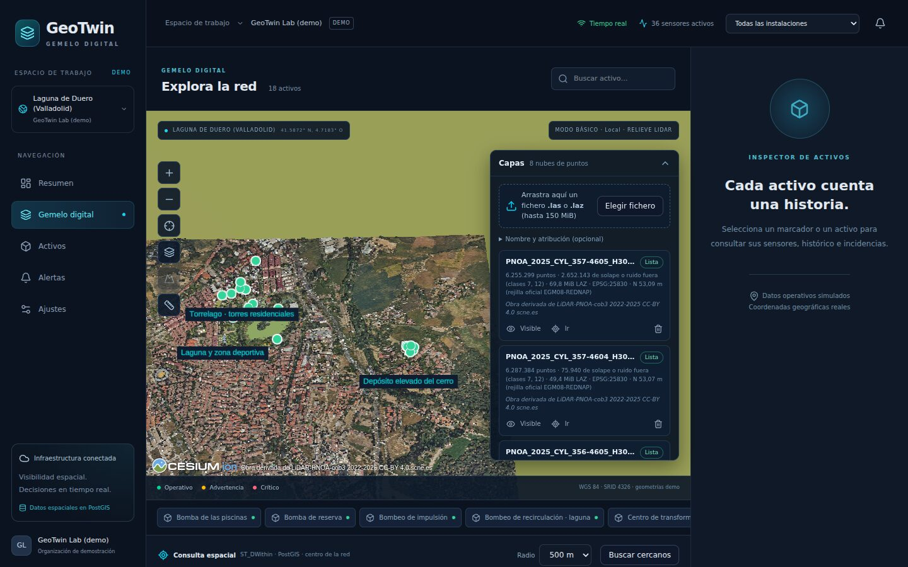

# Laguna de Duero con datos LiDAR reales

El escenario por defecto de la demo está en **Laguna de Duero (Valladolid)** y usa **ocho hojas reales de PNOA-LiDAR** (3.ª cobertura) procesadas por el mismo camino que cualquier subida: API → almacenamiento → cola pg-boss → worker → 3D Tiles. Las instalaciones y los activos son **ficticios** y su telemetría es **simulada**; solo su posición y su altura de montaje se han tomado de la nube de puntos. No son los sistemas reales del municipio.


## Los datos

| Dato      | Valor                                                                                                 |
| --------- | ----------------------------------------------------------------------------------------------------- |
| Origen    | PNOA-LiDAR, 3.ª cobertura (2022-2025), Castilla y León, vuelo de 2025 · © IGN-CNIG                    |
| Licencia  | CC-BY 4.0. Atribución obligatoria: **«Obra derivada de LiDAR-PNOA-cob3 2022-2025 CC-BY 4.0 scne.es»** |
| Hojas     | `PNOA_2025_CYL_<X>-<Y>_H30_NPC01.LAZ`, 1 × 1 km; el nombre es la esquina noroeste en km               |
| Cobertura | X 355-358 km, Y 4603-4606 km (ETRS89 / UTM 30N, EPSG:25830), salvo la hoja 355-4604; 8 km²            |
| Formato   | LAS 1.4, formato de punto 8 (RGB de 16 bits e infrarrojo), LAZ de 45 a 73 MB                          |
| Puntos    | 63,6 millones; unos 8 puntos/m² con el solape, 6 sin él                                               |
| Clases    | 1 sin clasificar, 2 suelo, 3-5 vegetación, 6 edificación, 7 ruido, 12 solape entre pasadas            |
| Alturas   | Ortométricas (REDNAP), de 692 a 770 m                                                                 |

Las hojas **no están en el repositorio** (488 MB). Se descargan del [Centro de Descargas del CNIG](https://centrodedescargas.cnig.es/) (LiDAR → PNOA-LiDAR → tercera cobertura, buscando Laguna de Duero) o, para quien tenga acceso al repositorio, de su release `data-laguna`:

```bash
gh release download data-laguna --repo davidpalmerojara/geotwin-cloud --dir data/laguna
```

## Cargarlas

Con la pila en marcha (Docker Compose o `npm run dev`), `scripts/upload-layers.sh` sube cada fichero por la API, espera a que la capa esté lista y continúa con el siguiente. Un fichero ya cargado (409) se salta.

```bash
scripts/upload-layers.sh data/laguna/*.LAZ                          # Compose: http://localhost:8080
scripts/upload-layers.sh -u http://localhost:3001 data/laguna/*.LAZ # npm run dev
```



Como los nombres empiezan por `PNOA_`, la API guarda en cada capa la atribución de PNOA-LiDAR y el visor la añade a sus créditos mientras alguna de esas capas esté visible (una sola vez, aunque haya ocho). Para que la corrección de alturas use la rejilla oficial del geoide, instálala antes (ver el README); sin ella se aplica EGM96, unos 0,5 m más alto aquí.

## Qué hace el pipeline con estas hojas

1. **Lectura completa** (laspy con lazrs): cabecera, CRS de la propia hoja (WKT de ETRS89 / UTM 30N), recuento por clase, alturas. El color de 16 bits pasa a 8 bits dividiendo entre 256; el infrarrojo no se guarda en las teselas.
2. **Una pasada de preparación**: deja fuera el **solape (clase 12)** y el **ruido (7)**, que en seis de las ocho hojas son casi un tercio de los puntos y en el modo Clasificación dibujaban franjas grises, y promedia el **suelo (clase 2)** en una malla de 2 m.
3. **py3dtiles** convierte los puntos que quedan de EPSG:25830+5782 a EPSG:4978 con la rejilla EGM08-REDNAP, punto a punto.
4. El **modelo del terreno** se rellena (pull-push), se pasa a alturas elipsoidales y se guarda junto a las teselas; el visor lo usa como terreno.

Medido en este entorno (4 CPU, `TILER_JOBS=3`, almacenamiento local, rejilla oficial instalada), subiendo las ocho hojas una detrás de otra con `scripts/upload-layers.sh`. «Total» es el tiempo desde que empieza la subida hasta que la capa está lista; las columnas siguientes son las etapas del worker.

| Hoja      | Puntos en el LAZ |      Dibujados |  Fuera (12, 7) |  LAZ (MB) | Teselas + MDT (MB) |  Ficheros | Total (s) | Lectura (s) | Copia y suelo (s) | py3dtiles (s) | MDT (s) | Subida (s) | Celdas con suelo |
| --------- | ---------------: | -------------: | -------------: | --------: | -----------------: | --------: | --------: | ----------: | ----------------: | ------------: | ------: | ---------: | ---------------: |
| 355-4605  |        8.659.476 |      6.034.826 |      2.624.650 |      65,8 |               97,6 |       934 |        30 |         3,5 |               6,0 |          16,6 |     0,2 |        1,2 |             90 % |
| 355-4606  |        8.897.485 |      6.013.635 |      2.883.850 |      65,6 |               97,3 |       993 |        31 |         3,3 |               5,3 |          16,0 |     0,2 |        1,3 |             90 % |
| 356-4604  |        5.965.064 |      5.964.407 |            657 |      44,7 |               96,5 |     1.068 |        28 |         2,7 |               4,4 |          15,3 |     0,2 |        1,2 |             93 % |
| 356-4605  |        8.307.389 |      5.828.781 |      2.478.608 |      62,8 |               94,3 |       991 |        31 |         3,3 |               5,8 |          15,5 |     0,2 |        1,1 |             74 % |
| 356-4606  |        8.303.446 |      5.649.066 |      2.654.380 |      64,9 |               91,4 |       879 |        31 |         3,3 |               4,9 |          17,6 |     0,2 |        1,1 |             78 % |
| 357-4604  |        6.363.324 |      6.287.384 |         75.940 |      51,8 |              101,8 |     1.273 |        34 |         2,8 |               5,1 |          20,0 |     0,2 |        1,7 |             90 % |
| 357-4605  |        8.907.442 |      6.255.299 |      2.652.143 |      73,2 |              101,3 |     1.472 |        37 |         3,7 |               5,8 |          19,8 |     0,2 |        1,8 |             83 % |
| 357-4606  |        8.187.753 |      5.625.678 |      2.562.075 |      59,4 |               91,0 |       803 |        30 |         3,4 |               5,7 |          16,2 |     0,2 |        0,9 |             96 % |
| **Total** |   **63.591.379** | **47.659.076** | **15.932.303** | **488,1** |          **771,1** | **8.413** |   **252** |             |                   |               |         |            |                  |

- **Memoria**: la suma de PSS del worker y de sus procesos de Python y py3dtiles no pasó de **694 MB** (muestreo cada 0,5 s durante las ocho conversiones).
- **Disco**: los ocho originales ocupan 488 MB y las teselas con sus MDT 771 MB (unos 16 bytes por punto dibujado: posición en float32, RGB y clase). La carpeta temporal de la conversión de la hoja más grande (357-4605) llegó a 219 MB (original, copia sin solape, teselas y MDT) y se borra al terminar.
- **Densidad**: se dibujan todos los puntos que no son solape ni ruido; no se aclara la nube. Quitar el solape, además de limpiar la imagen, ahorra un 25 % de espacio.
- El MDT tarda 0,2 s por hoja y ocupa 0,5 MB. «Celdas con suelo» es la parte de la malla con puntos de clase 2; el resto (edificios, la laguna, sombras) se rellena.

## Comprobación del datum vertical con los datos reales

Hecha aparte del código del worker: la ondulación N se ha leído directamente del GeoTIFF oficial `es_ign_egm08-rednap.tif` con interpolación bilineal propia, y las alturas elipsoidales de los puntos se han calculado desde sus coordenadas ECEF en las teselas servidas con una fórmula iterativa propia sobre GRS80 (pyproj solo empareja cada punto con el original en planta).

| Hoja     | Puntos de suelo comprobados | N en la hoja (m) | Residuo h − (H + N)           |
| -------- | --------------------------: | ---------------- | ----------------------------- |
| 356-4605 |                     200.000 | 53,088 a 53,121  | 0,05 mm (medio, RMS y máximo) |
| 357-4606 |                     200.000 | 53,084 a 53,116  | 0,05 mm (medio, RMS y máximo) |

El residuo de 0,05 mm es la diferencia entre los elipsoides GRS80 (el de ETRS89, usado en la comprobación) y WGS84 (el de EPSG:4978): a esta latitud, a·Δf·sin²φ ≈ 0,05 mm. Es decir, cada punto queda a su altura ortométrica más la ondulación oficial en ese punto. N varía unos 3 cm dentro de una hoja y de 53,07 a 53,14 m entre las ocho. Lo que queda es el error del propio modelo de geoide (centímetros), no del pipeline.

El **MDT** se ha comparado con los mismos 200.000 puntos de suelo por hoja: diferencia mediana de 2,1 y 2,4 cm, percentil 95 de 8 a 10 cm, sesgo medio de 0,0 cm.

## El escenario de la demo


`database/seeds/laguna-de-duero.sql` (el seed por defecto; `DEMO_SEED=valladolid` o `npm run db:seed -- valladolid` conserva el anterior) crea tres instalaciones ficticias con 18 activos y 36 sensores. Cada activo está en un sitio que se ve en la nube:

| Instalación                      | Dónde, según la nube LiDAR                                                                                         | Activos (ejemplos)                                                                                                                 |
| -------------------------------- | ------------------------------------------------------------------------------------------------------------------ | ---------------------------------------------------------------------------------------------------------------------------------- |
| Torrelago · torres residenciales | Torres de viviendas de 41-43 m (cubierta a 741 m de altitud, suelo a 699 m)                                        | Pasarelas LoRa en la cubierta de dos torres (montadas a 41,9 y 41,7 m), grupo de presión y centro de transformación a ras de suelo |
| Laguna y zona deportiva          | Laguna sin retornos láser (el agua absorbe el láser) de 3,4 ha, piscinas al aire libre, pabellón de 12,3 m, campos | Sonda de nivel en la orilla norte (con métrica de nivel en m), bombeo de recirculación, pasarela en la cubierta del pabellón       |
| Depósito elevado del cerro       | Estructura cilíndrica de unos 22 m de diámetro y 33 m de altura en el cerro del noreste (suelo a 732 m)            | Depósito (nivel en m) y pasarela a 33 m, bombeo de impulsión, válvula y transformador en la base                                   |

La estructura del cerro tiene la forma de un depósito elevado, pero la demo no afirma qué es: el activo es ficticio y la descripción lo dice. Cada activo guarda su **altura de montaje** sobre el suelo (`mount_height_m`), medida con la nube (clase 6 en la cubierta frente a clase 2 alrededor), y el visor lo dibuja a esa altura sobre el relieve del LiDAR. Sin relieve (sin hojas cargadas, o con «Relieve del LiDAR» apagado) no hay cubierta sobre la que apoyarlo: todos los activos se dibujan a ras del mapa y una nota en el visor dice cómo verlos a su altura. La sonda de la laguna es del tipo **sonda de nivel**. Las lecturas son simuladas; el nivel de agua avisa si sube por encima del umbral.

## Mediciones sobre la nube real

Hechas con la herramienta **Medir** del visor (clics sobre lo dibujado) y contrastadas con cálculos independientes:

| Medida                                                          | Herramienta                            | Comprobación independiente                                                                                                                                                                                      |
| --------------------------------------------------------------- | -------------------------------------- | --------------------------------------------------------------------------------------------------------------------------------------------------------------------------------------------------------------- |
| Altura de una torre de Torrelago (fila sur)                     | Desnivel −41,7 m                       | 41,8 m entre la mediana de los puntos de cubierta (clase 6, 1,5 m alrededor del clic) y de suelo (clase 2, 1 m) en esos mismos puntos; 42,3 m entre el nivel principal de la cubierta (percentil 95) y el suelo |
| Avenida al sur de Torrelago, entre dos glorietas                | 301,3 m horizontal, desnivel −0,46 m   | 301,26 m de geodésica (pyproj, WGS84) entre los dos puntos picados                                                                                                                                              |
| Superficie de la laguna (polígono de 28 vértices por la orilla) | 36.919 m² (3,69 ha), perímetro 929,9 m | 36.919,4 m² y 929,9 m con pyproj para los mismos vértices. Zona sin retornos en la nube: 34.204 m² de agua; el polígono incluye además la isla y el embarcadero                                                 |


Un clic toma la profundidad de lo dibujado: sobre una nube a 3 px por punto, el punto picado puede quedar unos 30 cm por delante del punto LiDAR (en la torre, el suelo picado quedó 27 cm por encima de los puntos de suelo). Las alturas de la tabla son las de la nube, no las de un plano de proyecto.

Un clic cae sobre lo primero que se ve en ese píxel: la copa de un árbol, un coche, una valla o una farola. Para medir el suelo, pica en pavimento despejado o marca **«Al suelo (MDT)»** en el panel Medir (aparece con el relieve del LiDAR activo): cada punto pasa a la altura del modelo del terreno en ese sitio, con su malla de 2 m.

## Límites

- Fuera de las ocho hojas el terreno es un **plano orientativo** a la altura mediana del MDT, que se funde con el borde de los datos en 400 m y vuelve al elipsoide a 30-60 km. Donde falta la hoja 355-4604 se ve ese plano.
- La laguna no tiene superficie de agua: en la nube es un hueco y en el MDT una superficie interpolada desde la orilla.
- Sin ion, la ortofoto PNOA del IGN no se pudo cargar en este entorno (red bloqueada); las capturas usan el mapa local de baja resolución bajo la nube.
- En las capturas, hechas con un renderizador por software (SwiftShader), las teselas lejanas aún no habían cargado su máximo detalle; con una GPU cargan en segundos.
- Una hoja de 2 × 2 km o más densa multiplica tiempos y disco de forma aproximadamente lineal; la subida pasa por la API (150 MiB por defecto).

## Vídeo

[Demo de 44 s](video/laguna-demo.mp4) ([WebM](video/laguna-demo.webm)): el gemelo sobre Laguna de Duero, cambio de modo de color (RGB, altura, clasificación), medición de una torre y una anomalía simulada en la sonda de la laguna. Grabado con un renderizador por software, por eso va a pocos fotogramas por segundo.
